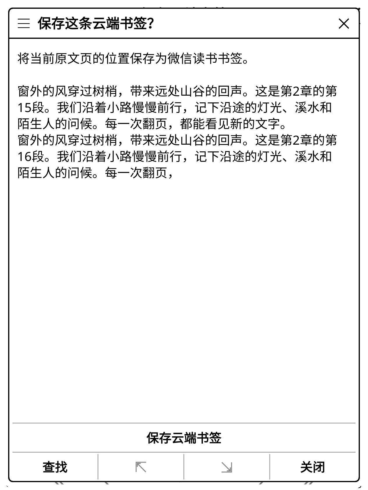
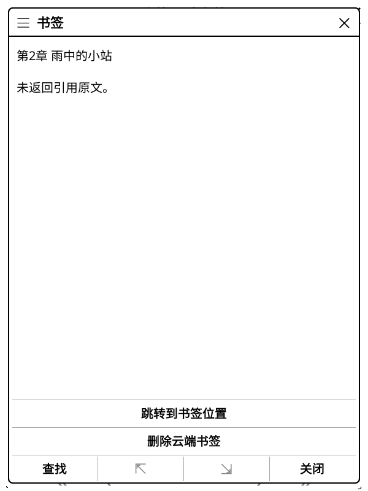

# 云端位置书签

普通数字书号的原文 EPUB 阅读菜单新增「保存云端书签」。后台从当前页可见正文核对原文位置，展示预览，再确认保存。
阅读菜单和书籍详情均提供「我的云端书签」，支持缓存离线浏览、跳转原文与单条删除；已有云端标记列表中的书签也提供相同操作。
没有返回书签文字时，列表使用章节信息，并明确提示未返回引用，不把本机文字冒充云端回包。

## 坐标与接口

参考 [MiuRead 原文范围模型](https://github.com/miumiupy98-art/miuread-koreader/blob/c1893562aa25a870b8dd076d7be062a3348f823e/miuread.koplugin/miuread/annotations/range.lua)
与[书签载荷](https://github.com/miumiupy98-art/miuread-koreader/blob/c1893562aa25a870b8dd076d7be062a3348f823e/miuread.koplugin/miuread/annotation_sync.lua)，先完成 Python 真实接口验证，再实现 Lua。
位置书签为 type=0、style=0，range 是单个十进制原文 Unicode 标量偏移，初始 BOM 不计入该范围。
它与划线的起止范围、阅读进度的过滤 XHTML UTF-16 坐标分别处理；不按百分比或邻近文字猜位置。

创建使用墨水屏 `POST /book/addBookmark`，提交 bookId、chapterUid、bookVersion、type、style、range、markText，
预览取核对后的原文最多 140 个 Unicode 标量；不发送 colorStyle 或推测的原生 chapterIdx。
删除使用 `/book/removeBookmark`，只提交选中且完整指纹未变的一条本人书签编号。
返回的预览可缺失；存在时必须与本次原文一致。CRLF、LF 和 Tab 保留，其他非法控制字符和无效 UTF-8 拒绝。

当前页采集、独立归档成员、原文与渲染哈希、目录章节号均须一致。
原文解析与 HTTP 在工作进程内执行；翻页、页面／滚动模式切换、账号、阅读会话、来源或译文模式变化使旧结果失效。
反向定位需要精确可逆锚点；纯图片、歧义或不支持的来源不会借用邻页位置。
导航不授予上传权限，不把书签直接写入 KOReader 本机笔记，也不修改下载文件。

## 发送与恢复

书签与划线复用账号 SQLite 的发送记录，派发前持久提交并原子领取，完整本人标记和想法在发送前及写后独立核对。
书签可与文字划线、想法共存；同章同点的重复书签在派发前拒绝。
创建只允许唯一匹配的新书签，删除只允许目标消失，其他完整投影保持保护。
章节派生描述沿用已验证的最后标记删除规则。

HTTP 成功不代替写后确认，回执丢失只回读，不重发。共用入口现名为「核对上次云端标记修改」，支持检查书签或划线的待确认状态。
原型工具的创建与删除额度分开领取；未知创建不能再创建，只能只读重建原计划、核对唯一新记录后使用原剩余删除额度。
未知删除可只读核对完整原状态后清理意图；重建失败、目标变化或原位置变化时不会派发。

## 已完成验证

真实账号的 Python 两次派发已完成并清理测试书签。首轮创建返回包含四处 CRLF 的 140 字预览，旧解析器拒绝 CR，流程按规则停止，没有重发创建。
只读诊断定位字段后，修正 Python／Lua 校验，独立重建原计划及唯一新目标，再使用原剩余的一次删除，独立核对原记录和 Web 位置一致、意图不存在。
合计两次账号数据 POST、零授权 POST；服务端排序、历史及未返回字段不属于完整恢复保证。
这本测试书原有本人标记为空，非空集合由离线对照保护，不据此宣称非空真实集合写入通过。

后续真实只读比较将原文、假设新书签及原集合经捕获管道传入 Lua；两份创建／删除计划和双向坐标与独立 Python 模型一致，零数据写入、零新意图。
本次真实正文、书签编号和凭据没有写入公开记录，没有真实截图；开发授权按用户要求继续保留在钥匙串。

官方 KOReader v2026.07.1 Linux ARM64 的 600×800／167 DPI、1264×1680／300 DPI 合成流程均通过：
当前页保存、重复拒绝、空回执独立确认、无预览书签、原生列表定位、单条删除、全新进程离线定位，原文件、本机笔记及原位置一致。
同轮划线／样式／想法回归及其全新离线待确认状态通过；调字号时先定位回保存的原生选区，再核对实际行框，避免把正常分页变化误判为划线丢失。

完整检查为 88 份 Python／1,068 项零跳过、221 组 Lua、617 个静态文件零警告／错误、619 个 Lua 语法、270 个 Python 编译、四时区、命名空间和 TLS。
固定候选、截图、首次停止与只读恢复、后续对照及检查结果见[证据](validation-assets/2026-11-11/cloud-bookmarks.json)。

真实账号的生产原生书签写后往返仍待补齐；本批原生界面写入只访问合成服务。
页面书签角标、非空真实集合写入、TXT／CB_／公众号、更多正文范围、整机中断、多设备及实体 KO2 仍待验收。
当前未检测到 Kindle USB 设备，实体 KOReader 版本未知；集中性能专项尚未开始。

