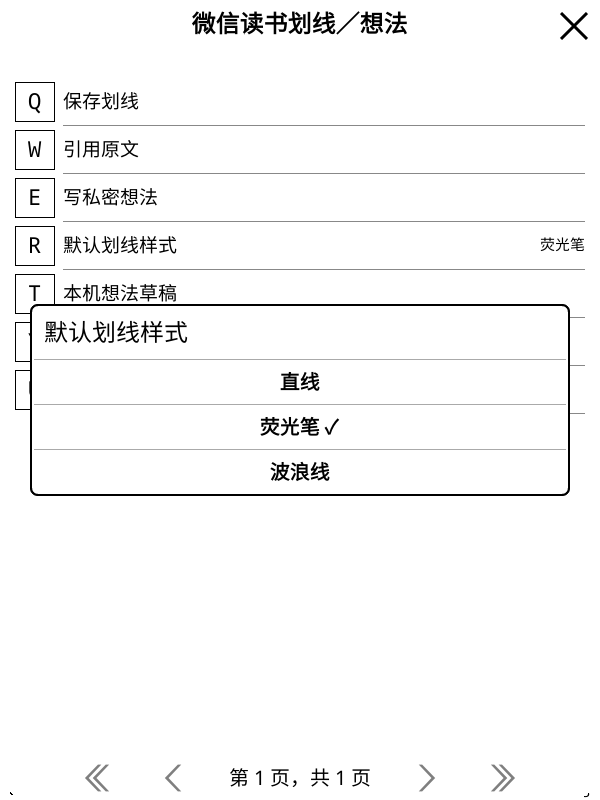

# 默认划线样式

在正文选中文字，打开「微信读书划线／想法」→「默认划线样式」，选择直线、荧光笔或波浪线。
所选值保存在本机，适用于后续新划线，初始值仍为荧光笔；缺失或无效的旧设置也使用荧光笔。
这是一项设备偏好，离线也可调整。已有划线、云端位置书签和想法不随默认值改变。

点击「保存划线」时取得样式快照，确认窗口同时显示本次样式和引用。
后台核对、持久发送记录及请求摘要均绑定该快照；确认期间改动默认值只影响下一条划线。
创建时直接提交已选样式，不先创建再追加修改；颜色使用独立的本机默认值，初始仍为服务端默认色 0，
选择与验证范围见[颜色说明](highlight-colors.md)。本页原样式批次固定使用颜色字段 0。
写后完整回读必须匹配该样式、范围和引用；收到其他样式不能认定成功，未知结果仍只读核对、不重发。

## 协议与原生验证

现有创建流程原先固定为荧光笔。本项先新增独立 Python 原型，实际证明直线与波浪线可直接创建后才接入 Lua。
两个同计划零写入预演后，分别「新建直线→独立回读→删除→独立回读」和「新建波浪线→独立回读→删除→独立回读」，
总计四次数据 POST、零授权 POST。每步保护完整原有标记、本人想法、书架标记与原生精确位置；
末尾另核对 Web 位置，原记录和位置一致，测试记录与独立钥匙串意图清理。
该一次性执行已消费，不重跑；排序、历史及服务端未返回字段没有完整恢复保证。

后续只读核对使用真实原记录与原文选区，Python／Lua 的七份创建、删除和修改样式计划完全一致。
删除及修改样式计划采用明确标识的假设新增记录，不选择原有记录作为修改目标；本轮没有额外账号修改。

原生合成场景使用官方 KOReader v2026.07.1 Linux ARM64，覆盖两个尺寸的真实选区菜单、样式弹窗、确认、
后台请求、SQLite、直接创建与删除、正文图层及新进程零 HTTP 离线重开。
确认期间改变默认设置后仍按原预览发送；账号、阅读器、页面、原文位置或弹窗改变后，旧选择回调失效。
文件、本机附注与原生位置保护沿用原流程。真实数据的直接创建由 Python 验证，原生新增组合使用合成服务。

组合验收还复现了旧测试的前置条件问题：书签定位及字号重排正确撤销上传资格，随后关书测试却假设资格仍有效。
修改前提交的独立基线也出现同一失败。现改为通过插件同步入口重新比较，需要选择时明确保留本机位置，
完成核对后才开始独立的关书上传用例；离线显示测试则先定位缓存划线，再恢复重开位置。
生产同步资格检查没有放宽。

固定记录及合成截图见[本批证据](validation-assets/2026-11-12/default-highlight-style.json)。
完整离线检查为 94 份 Python／1,145 项零跳过、223 组 Lua、625 个静态文件零警告／错误、
627 个 Lua 语法、292 个 Python 编译、四时区及 TLS；两个尺寸的 250 个生产文件均与候选包及实际安装逐字节一致。
颜色选择的后续进展见[颜色说明](highlight-colors.md)。更多格式与真实非空集合写入仍待完成；实体 KO2、断电及集中性能专项不属于本项验收。

