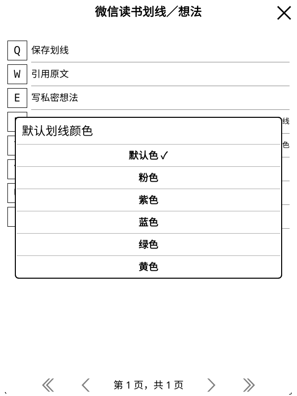
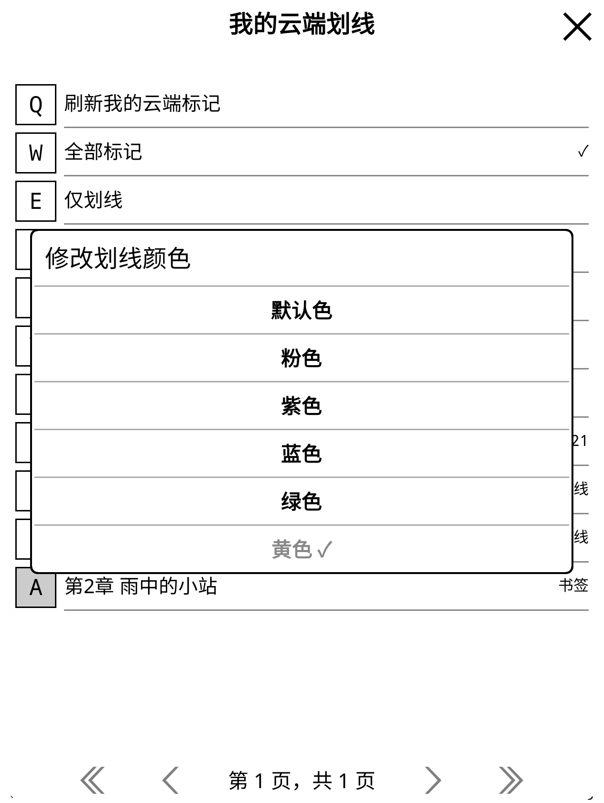

# 划线颜色与默认颜色

正文选区的「微信读书划线／想法」新增「默认划线颜色」，可选默认色、粉色、紫色、蓝色、绿色、黄色。
本机偏好离线可调整，初始为默认色；缺失或无效的旧设置也使用默认色。
保存新划线时同时冻结样式与颜色，确认期间修改偏好只影响下一条划线，不追加第二次修改请求。

「我的云端划线」的引用窗口新增「修改划线颜色」。当前颜色显示勾选并禁止重复提交；
确认窗口显示目标颜色，后台重新核对所选记录及完整本人标记／想法，再提交一次修改。
改色保留原样式，改样式保留原颜色设置。位置书签、未知样式／颜色的记录不提供改色入口。
有关联本人想法的普通划线可以改色，其想法与引用仍受完整回读保护。

颜色信息沿用按账号保存的 SQLite 标记缓存，默认偏好为一个有界数字。
全新离线进程可以显示已保存颜色及默认值；离线提交不会发送请求。
正文继续使用墨水屏黑色线条与灰色荧光笔，颜色名在原生选择窗口显示并保存到云端。

## 协议来源与确认

编号及命名参照[官方公开阅读器固定资源](https://cdn.weread.qq.com/web/wrwebnjlogic/js/9.625560b7.js)：
0 为默认色，1 粉色、2 紫色、3 蓝色、4 绿色、5 黄色；默认色随线型选择。
该资源本次重新读取的 SHA-256 为 `ba993fec345c6f2e498379b729ebcbb306fb54bfb398a8d396bc62c7ce954203`。
请求形状参考 [weread-omni 固定版本](https://github.com/teng-lin/weread-omni/blob/88bd2e095d7d7ee423eaadf8f40653e72c5be6d4/src/api/resources/notes.ts)。
先完成独立 Python 真实验证，才接入 Lua。

新建直接携带颜色；改色使用 `/book/updateBookmark`，只提交所选编号、原样式及目标颜色。
发送前持久保存请求摘要并原子领取，写后独立读取完整集合。
只有该记录的颜色符合预期、其他字段与原有记录一致，才完成发送记录；HTTP 200 本身不代表确认成功。
未知结果保持待核对，只读核对入口不会重发；账号、阅读器、菜单及弹窗的旧回调继续失效。

## 真实验证与中断记录

使用全新测试划线验证五种非默认颜色的直接创建和六种颜色修改；同一时刻最多一条新增记录。
真实样本固定为荧光笔线型。原有标记、本人想法、全体书架标记与原生精确位置逐步核对，末尾另核对 Web 位置。

最初的连续试验没有通过：验证工具沿用旧的 80 次 GET 额度，在七次修改均已独立确认后、删除尚未领取时停止。
该停止已通过真实限额类离线复现。新调色板流程单独计算最多 277 次读取，限额设为 280；原有试验默认仍为 80。
这次失败记录和已消费启动记录均保留，没有重跑原七次修改。

只读诊断确认新增记录的指纹和原状态。第一次清理前置检查因验证器未指定 Web 书号而停止，零数据修改；
补齐作用域后，只发送一次尚未领取的删除，独立核对全部原记录与位置恢复。
然后仅接续原计划中八个从未领取的额度，重新核对原账号、目录、原文选区、来源及所有原状态摘要，
完成其余四种颜色的新建／删除。已领取或结果未知的步骤不能从此入口恢复。

三个执行阶段合计十六次数据 POST（7＋1＋8），全部测试记录及专用意图已清理。
原始连续试验保持未通过；组合结果证明五种非默认创建值、六种修改值及原状态恢复。
排序、历史、并发修改和服务端未返回字段不属于完整恢复保证。

后续只读 Python／Lua 模型核对初次观察到真实 HTTP 401，当时零数据或授权修改、无测试意图。
仅执行一次受保护续期，核对同账号 140 本书架及钥匙串保存回读；未返回刷新令牌时保留原值。
再执行的十九份真实来源模型计划完全一致，没有额外账号数据修改。
删除及修改计划使用明确标识的假设新增行，不选择原有记录作为测试目标。

## 原生与离线范围

官方 KOReader v2026.07.1 Linux ARM64，600×800／167 DPI、1264×1680／300 DPI 的完整组合流程均通过：

- 实际默认色选择、离线设置、三种线型及两个非默认颜色的直接创建；确认期间改变偏好后仍发送原快照。
- 六种逐条改色、保留样式／引用／时间及其他记录；空回执独立确认、未知改色保留 SQLite 意图、只读核对零重发。
- 保留原有未知样式修改的新进程验证，同时核对新进程的默认颜色与每条缓存颜色，离线界面显示当前勾选值，零 HTTP。
- 正文、原生位置与本机附注保护，首页／书架／书城、下载、同步、关书恢复及书架状态流程回归。
- 251 个生产文件在两个尺寸均与对应候选包和实际安装逐字节一致。

95 份 Python／1,166 项零跳过、223 组 Lua、627 个静态文件零警告／错误、629 个 Lua 语法、
296 个 Python 编译、四时区与 TLS 通过。原生新增流程全部使用合成服务，不据此声明真实原生改色往返通过。
固定证据见[本批记录](validation-assets/2026-11-12/highlight-colors.json)。
代码提交 `cdae1a6` 的 [GitHub CI](https://github.com/szxypi/weread.koplugin/actions/runs/43078555118) 全部通过，保留原有检查。
非空真实集合写入、其他来源格式、多设备并发、断电与实体 KO2 仍待验收；集中性能专项尚未开始。

