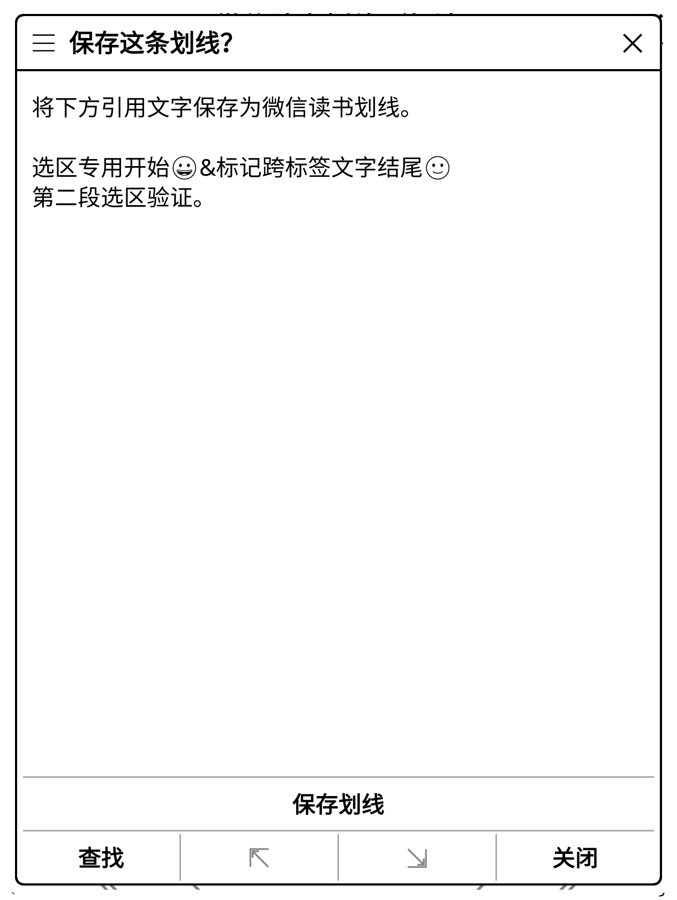
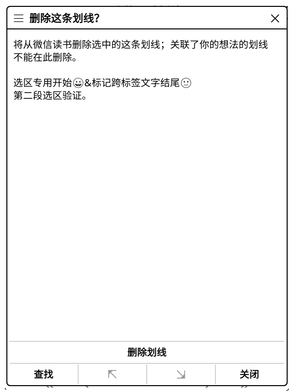

# 原生云端划线保存与删除

原文 EPUB 选中文字后，可从「微信读书划线／想法」进入「保存划线」；
「我的云端划线」中的单条划线新增「删除划线」。两个操作都先在后台核对完整本人划线与想法，
显示完整引用，再由用户确认提交。与本人想法关联的划线不允许在此删除，已有划线覆盖的选区不重复创建。
选区保存还会核对归档与远端原文、账号、目录及原生书籍版本，不把 Web 目录序号猜成原生章节序号。

划线使用独立的账号 SQLite 待确认记录，复用想法编辑已经测试的工作进程、取消和持久发送门槛。
首次可能发送前以 `synchronous=FULL` 提交，原子领取只允许一次派发；切书、换账号、原文变化或取消使旧预览失效。
HTTP 成功本身不能确认修改，只有独立完整回读匹配新集合才更新缓存并清除记录。
不明确的结果留待「核对上次划线修改」只读处理，重开、重按和丢失回执均不会自动重发。
确认记录只含编号、版本及摘要，不保存登录、引用或完整请求正文；完整标记和想法仍使用原有独立配额缓存。

## 实际接口验证

先用 Python 完成只读预演，再创建一条与已有笔记不重叠的新测试划线。
独立回读核对唯一新增编号、原文范围、完整引用、类型、样式和颜色；再次完整读取后，仅删除这条新记录并回读。
本次恰好两个账号数据 POST，分别为 `/book/addBookmark` 和 `/book/removeBookmark`，没有写入重试或授权续期。
原有划线、本人想法、章节描述、书架标记及原生／Web 精确阅读位置与基线一致，新增测试划线消失。
独立钥匙串实验意图清除并由新实例确认不存在，登录继续保留到整体目标完成。
服务端排序、历史及未返回字段不属于完整恢复保证；相同内容的并发操作也不能仅凭回读证明因果关系。

这次真实删除的是独立新建的普通划线，**不是想法删除后残留的关联划线**；后者的条件清理场景仍待真实验收。
此前新选区三步没有调用删除划线接口的历史结论，见[当时记录](selection-trial-validation.md)。

后续原生真实运行发现最后一条划线删除时，服务端会同时移除所选章节的派生索引；
该情况已完成独立真实诊断及限定确认修复，见[最后一条划线说明](highlight-last-mark.md)。

另一次真实数据只读比对确认 Python／Lua 的完整快照、请求和全部核对摘要一致。
创建计划使用真实新选区；删除计划使用附加在真实基线上的假设新记录，没有以原有的关联划线作为删除目标。
这次比对没有数据写入，也不替代原生生产路径的真实写入验收。

## 原生运行与回归

官方 KOReader v2026.07.1 Linux ARM64，600×800／167 DPI 和 1264×1680／300 DPI：

- 实际原生选区、完整引用与表情显示、确认保存、本人划线列表删除，后台工作进程及提交前持久记录均通过。
- 离线零写入、关联想法阻止删除、原文变化拒绝提交、取消预览拒绝派发均通过。
- 丢失回执后通过独立回读确认；未知结果保持 pending，重复提交被阻止，只读处理不重发。
- 全新离线进程保留划线待确认记录；阅读位置、本机原生笔记及原有云端合成记录一致。
- 两份候选各 241 个文件与源码及实际安装内容逐字节一致；另有真实 SQLite 双进程领取竞争与新实例恢复测试。

上述原生界面使用封闭合成服务，真实账号数据 POST 为零；不声称已经完成原生两次真实写入或实体 KO2 验收。
80 份 Python／990 项零跳过、213 组 Lua、595 个静态文件零警告／错误、597 个 Lua 语法、
242 个 Python 编译、四时区、命名空间和 TLS 核对通过。
固定计数、候选摘要、原生结果和隐私审计见[证据](validation-assets/2026-11-11/highlight-editing.json)。

当前限于普通数字书号 EPUB 的原文选区和普通划线保存／删除；不包含样式修改、位置书签写入、
关联想法清理、所有格式／范围、立即重绘正文标记、多设备与实体设备验收。
新云端划线可在本人划线列表中核对，正文仍沿用原有章节批注读取流程。
集中性能专项仍安排在功能验收完成之后。
