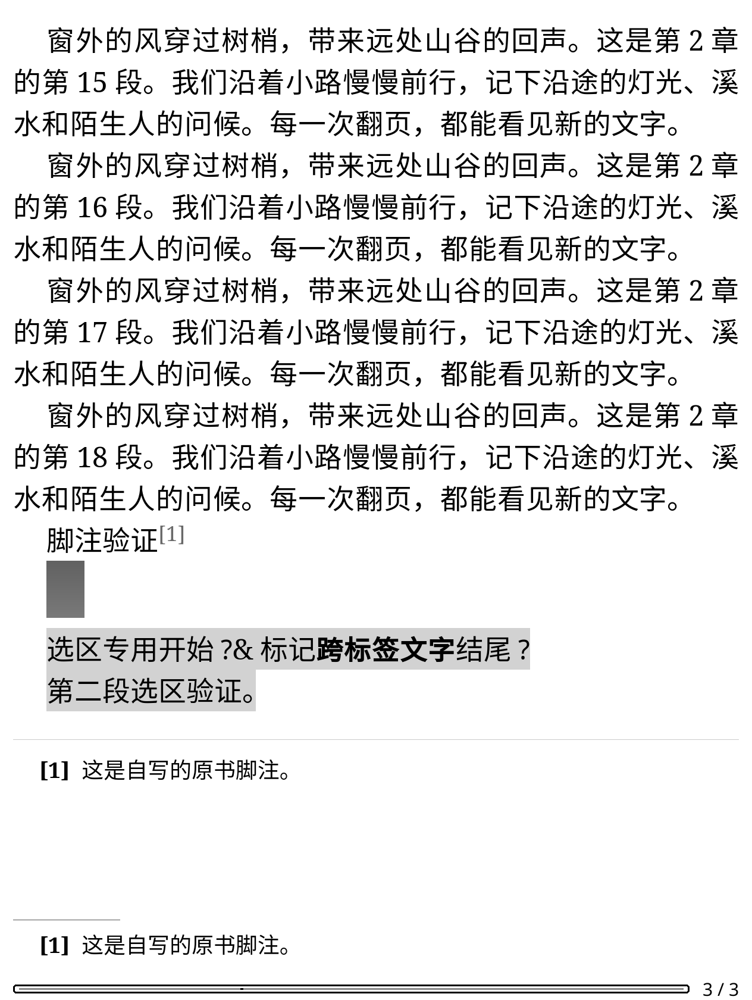
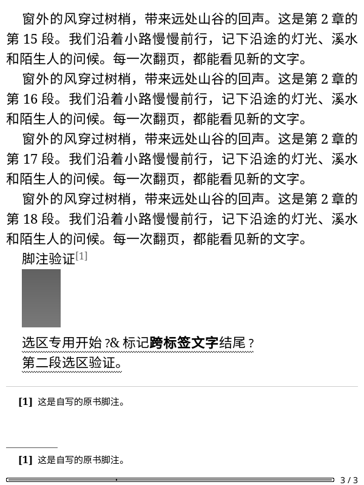

# 个人划线样式

「我的云端划线」的单条原文弹窗新增「修改划线样式」，可选择直线、荧光笔或波浪线。
当前样式显示勾选且不重复提交。确认窗口展示完整引用和目标样式，后台先重新核对完整本人划线与想法，再确认发送。
正常数字书号的原文 EPUB 会同步更新正文个人图层；离线重开继续显示已保存的样式。

## 接口与原生显示

样式编号由[官方公开阅读器资源](https://cdn.weread.qq.com/web/wrwebnjlogic/js/9.625560b7.js)核对：直线为 0、荧光笔为 1、波浪线为 2。
请求形状参考 [weread-omni 固定版本](https://github.com/teng-lin/weread-omni/blob/88bd2e095d7d7ee423eaadf8f40653e72c5be6d4/src/api/resources/notes.ts)，
独立 Python 真实验证通过后才接入 Lua。
使用墨水屏 `POST /book/updateBookmark`，只提交所选 bookmarkId、目标 style 和原有 colorStyle。
没有重新创建划线，也不修改引用、范围、章节或其他记录。
当前编辑要求已知的普通文字划线与颜色设置；位置书签、未知类型不显示这个入口。

保留的是 colorStyle 字段；0 代表服务端默认色，其他客户端可能按样式选择不同的默认显示色。
本插件的墨水屏正文使用黑色直线、灰色荧光笔背景和黑色波浪线区分样式，不提供颜色修改。
荧光笔使用 KOReader 同类笔记的灰度混合方式保留文字；相同行框的重叠片段合并后绘制一次。
三种效果只作用于独立视图图层，不修改 EPUB、本机笔记、正文位置或同步权限。

## 确认与恢复

沿用账号 SQLite 的独立划线发送记录，首次可能派发前 FULL 提交并原子领取。
发送前重新读取完整集合；确认条件为所选行仅 style 发生预期变化，其他行、章节描述与本人想法完整投影保持一致。
颜色、引用、范围、编号、创建时间或其他记录改变，均不能当作样式成功。
有本人想法关联的划线可以改样式，但仍不能从普通删除入口移除；想法内容保持保护。

HTTP 成功不是最终确认；回执丢失后仅独立读回，不重发。
未知结果保持待核对，重复点击、重开或再次进入均不自动提交；通过既有「核对上次划线修改」读取当前状态。
账号、阅读器、菜单或原文模式变化、取消及休眠沿用既有任务归属和旧回调保护。
样式预览离线时不派发，离线显示使用已保存快照。

## 验证范围

先进行真实 Python 预检，再对一条新建测试划线执行：荧光笔创建→直线→波浪线→删除。
恰好四次账号数据修改，每步独立完整回读，颜色设置、原有标记、本人想法、书架标记及精确阅读位置一致；
这一轮没有授权续期，使用默认颜色字段 0，测试记录及专用意图清除。服务端排序、历史和未返回字段不属于完整恢复保证。
另一轮只读核对将真实账号集合与假设新增测试行组合，Python 与 Lua 的创建、删除及三种样式计划共五份完全一致，没有数据修改或新意图。

原生合成流程使用官方 KOReader v2026.07.1 Linux ARM64，600×800／167 DPI 与 1264×1680／300 DPI：
实际菜单、确认、两次样式修改和正文效果、空回执独立确认、未知样式结果、全新离线进程的待核对状态及波浪线恢复；
文件、本机笔记与阅读位置均保持一致。受限原生四步执行器另核对每步宿主独立回读，已完成每尺寸 10 种场景、共 20 组运行，另对旧两步划线执行器在两尺寸分别回归正常场景。
随后 600×800 的真实原生四步往返通过：四次生产派发、每步宿主独立回读，三种正文效果及完整引用均核对成功；
原生位置、本机笔记、本人标记缓存与原记录保持一致，最后删除测试记录，专用发送意图、工作进程及 tmpfs 配置清理通过。
未拍摄真实正文截图；两尺寸样式截图全部来自合成夹具。

初次真实原生准备在墨水屏书架读取遇到 HTTP 401，尚未启动原生进程或占用写入额度；
独立授权维护仅执行一次，核对同账号 140 本书架和钥匙串回读后再做禁止发送预演，确认零数据派发、零占用，才启动新四步计划。
本批真实账号数据派发总计八次（Python 四次、原生四次），授权 POST 一次；没有重跑已消费的测试。

全部检查为 84 份 Python／1,036 项零跳过、217 组 Lua、608 个静态文件零警告／错误、610 个 Lua 语法、258 个 Python 编译、
四时区、命名空间和 TLS；固定候选、静态检查、原生流程及隐私核对见[证据](validation-assets/2026-11-11/highlight-styles.json)。

当前没有修改保存划线的默认样式（仍为荧光笔），也未加入颜色选择、位置书签或想法删除后的关联划线清理。
后续位置书签进展见[独立说明](cloud-bookmarks.md)，共用待确认入口现名为「核对上次云端标记修改」；本页原批次证据保持不变。
实体 KO2、更多书号与来源格式、整机中断及集中性能专项仍待验收。

