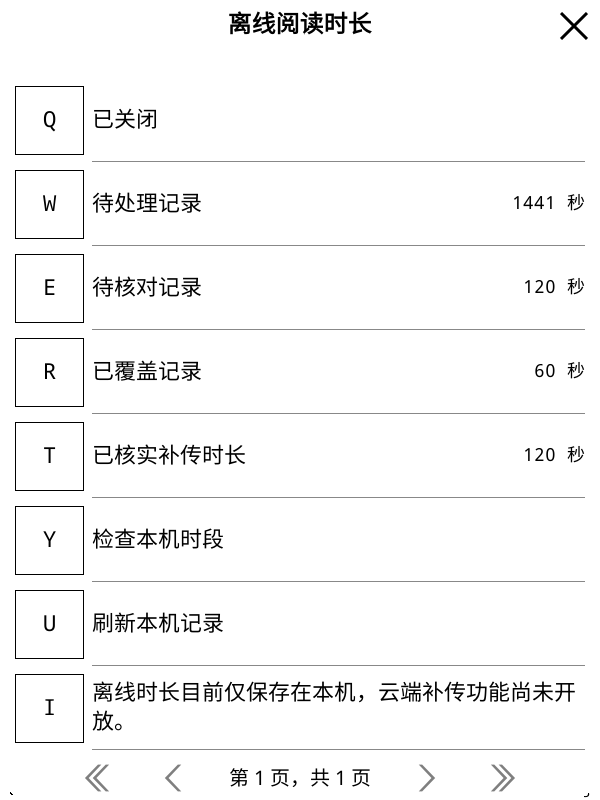
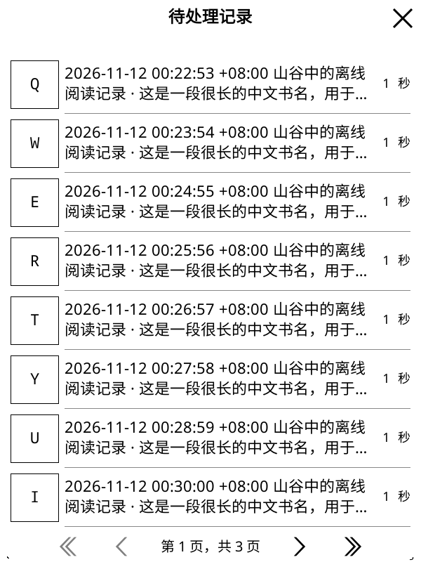
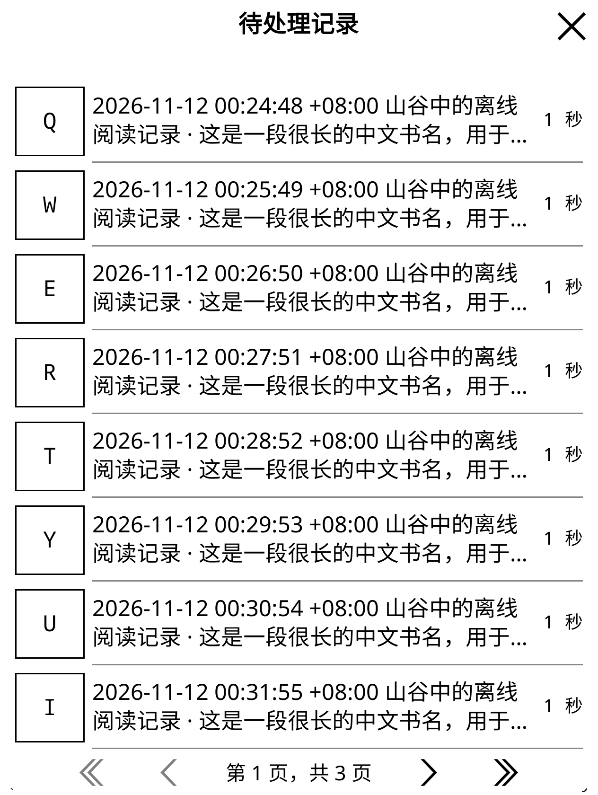

# 原生离线时长账本

“离线阅读时长”现打开原生账本，分别显示待处理、待核对、已覆盖记录和累计已核实补传时长。
可以翻页查看单条记录、捕获时间、时区及下载时保留的来源信息，也能运行本机时段检查。
这些操作不发送时长，不把未知结果改成成功；历史补传仍未启用。

## 原生查看与生命周期

摘要、列表、详情和检查在独立工作进程中读取 SQLite，结果仅经过有界管道返回。
每次列表最多读取二十条，记录上限和游标在进入分类时固定；新记录要刷新后才进入本次列表。
被移除或改变来源的旧记录不能从旧按钮重新打开。捕获时间优先显示，长书名不会遮住区分记录的时间。

时间按捕获时区显示。已保存下载时的文件指纹和版本只说明保留了当时的来源信息，
不能解释为已重新核对当前文件、云端版本或可成功补传。
结果不明、重叠及缺少来源信息的时段保留，并说明为什么需要继续核对。
“已覆盖”与“已核实补传”分开：前者用于防止重发已保留给其他上报的时间，不能作为云端入账证明。

退出、点外关闭、等待窗取消、账号或登录变化、切书和休眠会关闭相关视图并取消工作进程。
旧页按钮和晚到结果不能打开已经结束的账本。关闭弹窗后不会再调用旧返回按钮。
没有新增删除、确认成功、重发或清理未知记录的操作。

## 分页来源选择

`readtime_transfer_queue.lua` 逐页向后检查，避免最早的一百条未知来源记录挡住后续有效记录。
每次只选择同一本书、同一捕获文件、版本和时区，最多一百段／六百秒；
不会拿当前书籍的版本改写旧记录，也不会领取、拆分或结算账本。

选择分别排除在线／离线已经保留的区间、覆盖记录启用前的时间、未知来源、未来时段和其他本机记录的重叠部分。
仅排除交叠部分，同一行剩余的非重叠时间仍可选。
例如两条记录为 `[100,160)` 与 `[130,190)`，本次可选 `[100,130)` 和 `[160,190)`，
交叠的 `[130,160)` 保留待核对；在线覆盖与本机歧义分别计算。
跨页结果仍使用发送协调层的原行和选区摘要，未来领取时必须在事务中重新核对。

所有记录最多五万行。无效时长、超界时间、损坏状态或孤立行不能被索引范围查询漏过，
账本检查和领取都会停止，而不是跳过损坏行后继续发送。
重叠查询额外采用整数转换与最多六十步的硬上限，兼容把参数绑定成文本的 SQLite 驱动。
最初单元测试在无此限制时未结束，已停止该测试进程；一个带结果上限的独立复现确认
旧查询超过正确的六十行，修正后恰为六十行。该失败没有发布或接触真实账号。

## 检查范围

新增真实 SQLite 的 56 项检查，覆盖跨页未知来源、不同文件／版本、部分重叠、跟踪起点、
固定游标上限、记录分类、损坏数据及计划之后来源变化；另有 40 项原生界面控制检查，
覆盖异步读取、翻页、返回、取消、账号／登录／文档／会话变化、晚到结果和关闭后的旧按钮。
历史 HTTP 发送仍由[独立协议验证](readtime-history-recovery.md)限制。

真实 KOReader 原生运行使用额外隔离的 146 条合成记录，其中前 121 条来源未知，
另外包含处理中、结果不明和已覆盖记录；已核实时长 120 秒是合成汇总，不代表真实补传成功。
实际工作进程与 SQLite 覆盖分类、前后翻页、长中文书名、来源说明、重叠说明、六百秒本机选择、
旧按钮、等待窗取消、弹窗关闭和休眠。原生统计插件此前实际采集的秒数及文件来源另行核对，保持不变。
账本查看期间没有新增阅读上报请求，其他原生阅读／下载／同步回归也通过。

最终 100 份 Python／1,228 项零跳过、228 组 Lua、640 个静态文件零警告／错误、642 个 Lua 语法、
312 个 Python 编译、四时区、命名空间及 TLS 检查通过。

两种尺寸的固定结果、截图及安装字节核对见[去敏记录](validation-assets/2026-11-12/offline-time-review.json)。
两套候选各 258 个文件与源码和实际安装逐字节一致，十六张绘制均使用合成数据。

| 600×800 分类 | 600×800 时间优先列表 | KO2 尺寸列表 |
| --- | --- | --- |
|  |  |  |

这些绘制是合成服务验收，不能代替真实历史入账、多设备、实体 KO2 或断电验收。
集中性能专项继续安排在整体功能测试完成后。
