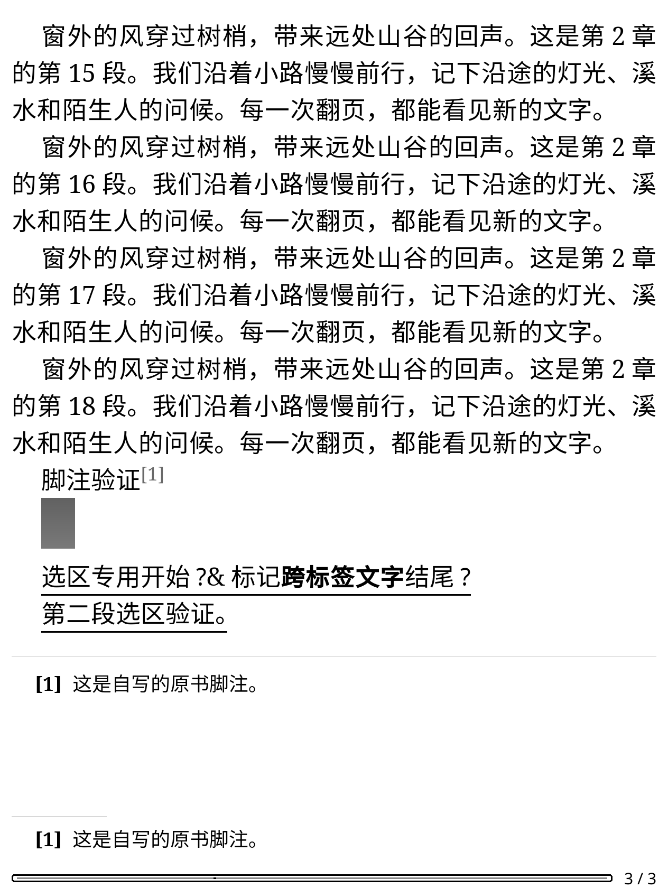
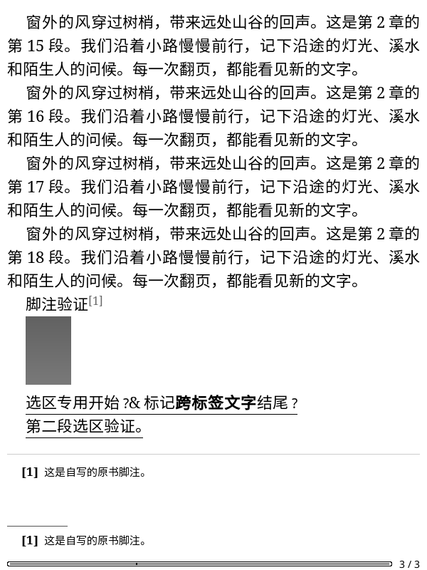

# 正文中的个人云端划线

普通数字书号、带可靠来源记录的原文 XHTML EPUB，现在可以直接在 KOReader 正文中显示本人云端划线。
保存或删除划线并经独立回读确认后，更新当前阅读器的个人划线图层；不必重新下载章节。
点击划线打开本人划线原文弹窗；「显示／隐藏划线与想法」同时控制这一图层，字号变化后重新计算实际行框。
离线重开可以从按账号的 SQLite 快照恢复。书签和未知类型不作为文字划线绘制。

## 数据与位置

个人划线不进入公共批注库，也不写入 KOReader 本机笔记数组或下载的 EPUB。
打开书籍时，后台先读取本账号缓存；有可用墨水屏登录且联网时最多读取一次本人完整标记。
这条自动读取不触发续期或登录，不明确的读取失败保留旧缓存；显式刷新继续使用既有本人标记页面。
完整保存新快照后才采用它，保存失败重新读取旧缓存。开始编辑会取消旧读取，防止迟到结果覆盖已经核对的修改。

微信读书标记范围按原始 HTML Unicode 字符计数，而原文位置按过滤后的 XHTML UTF-16 计数。
独立 Python 先验证两个端点、完整引用及摘要，Lua 使用相同输入独立比较。
后台重新打开归档，核对书籍／版本／文件身份、章节编号与路径两份元数据、原始正文和实际渲染成员。
引用仅容许裁去两侧空白；不改写中间文字，也不把范围长度直接加到原文位置。

原生 DOM 两个端点分别核对唯一上下文和精确前缀，再将整个原生规范化区间送入后台核对完整引用摘要。
长划线继续核对全文，不受选区编辑器 4 KiB 引用限制。
上下文优先取自已验证选区内部，避免相邻脚注移动后把短选区定位到旧邻居。
不足以唯一定位、实体边界不完整、原文变化或中间出现额外生成文字时跳过，不绘制近似范围。

归档、正文解析与摘要在后台；原生 DOM 遍历分段让出事件循环。
工作按章分批，每批最多 8 条，单段原生核对上限 512 KiB，工作结果管道上限 8 MiB。
仅保留当前章节的原生位置，翻到其他章节重新核对，持久快照继续沿用单本 4 MiB／5,000 条、最多 64 本／32 MiB 的既有配额。
这是功能所需的有界执行；集中性能专项仍在整体验收之后。

每次工作绑定账号、授权代次、书籍、文件、阅读会话及来源元数据。
切书、换账号、关书、隐藏、休眠或离开原文模式时取消旧工作；迟到回调不能保存快照或绘制旧位置。
有原生选区时延后 DOM 工作，避免清除用户正在选择的文字。恢复显示、唤醒和回到原文后从已核对缓存重新构建。
不导航正文、不上传位置、不授予原文坐标上传权限，正常阅读原有同步设置继续生效。

## 验证

官方 KOReader v2026.07.1 Linux ARM64，600×800／167 DPI 与 1264×1680／300 DPI：

- 封闭合成服务的原生保存、正文显示、隐藏／恢复、点击本人原文、字号变化和删除后消失均通过；文件、本机笔记及原位置保持一致。
- 另在本机合成缓存种入一条有效测试划线，全新离线进程恢复正文图层，HTTP 请求为零；这条缓存夹具没有发送到云端。
- 两章／六条合成划线，包含短引用、中文、实体和表情，两尺寸正序定位及全新进程逆序定位通过；完整原生引用与保存文字逐条一致。
- 既有受限原生划线两步执行器另做正常场景回归，仅两次合成 POST、独立核对与最终清理通过，没有真实写入。
- 单元测试覆盖迟到读取、保存失败回退、原生选区延后、账号／章节／翻译模式变化、休眠恢复、归档损坏及完整引用不匹配。

真实账号的范围预检完成 52 条划线／5 个章节的 Python 与 Lua 两端点／锚点核对，未修改云端数据。
随后在 600×800 的实际原生阅读器中逐条打开同一批真实划线，完整原生引用、实际可见行框与所选标记一致；全新离线进程逆序再核对 52 条全部通过。
两轮原生进程 HTTP 为零，文件、本机笔记及当时视口不变，所有工作进程回收、隔离 tmpfs 配置清理通过。
宿主前后读取仍确认完整云端标记与精确位置一致，没有账号数据 POST 或授权 POST。
真实正文未截图；KO2 分辨率本轮使用合成数据，未将真实 600×800 结果描述为两个尺寸的真实渲染验收。

检查共 82 份 Python／1,016 项零跳过、216 组 Lua、605 个静态文件零警告／错误、607 个 Lua 语法、
251 个 Python 编译、四时区、命名空间及 TLS 核对通过。容器缺少命名空间检查所需的搜索工具，该项已在宿主执行通过。
固定候选、实际安装范围和结果见[本批证据](validation-assets/2026-11-11/personal-highlight-display.json)。

当前不扩展 TXT、CB_、公众号、译文映射或旧缓存来源猜测；不修改划线样式、位置书签或关联想法。
实体 KO2 的按键、联网、休眠和断电恢复仍待连接设备，两个分辨率的原生运行不算真机验收。

