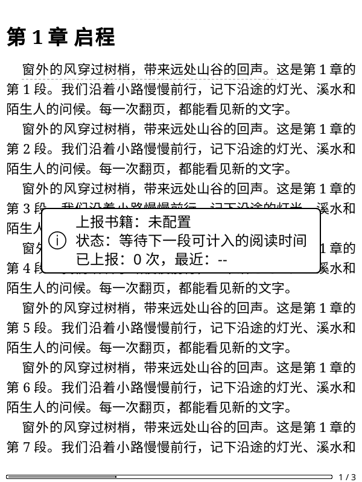
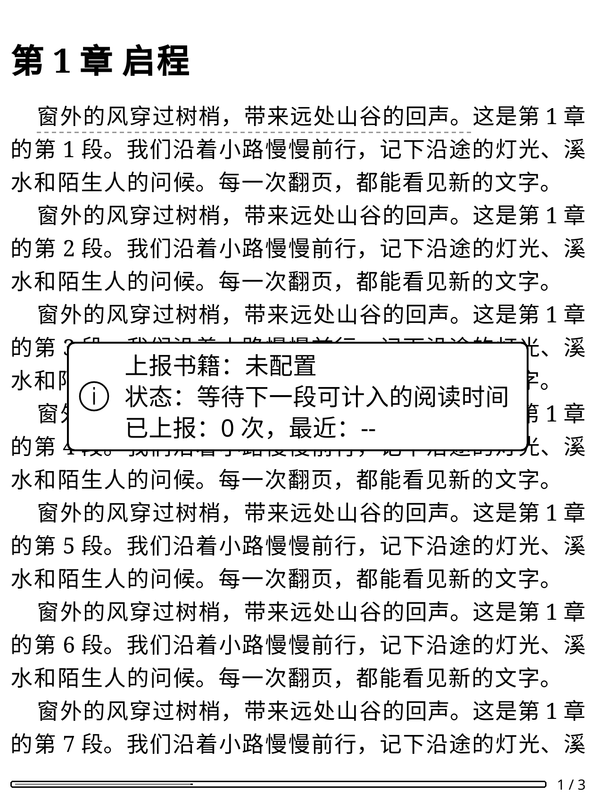

# 离线时长队列与在线发送协调

本轮补齐本机持久队列、领取及结算恢复，并让在线上报先检查离线时段。
历史时长补传仍未完成：一次历史窗口请求收到成功回执，但独立统计未增加，记录继续待核对且不重发。
因此没有启用历史账本发送器或新增补传按钮。此前当前窗口协议验证见[前一阶段](readtime-upload-protocol.md)。

## 本机队列

`readtime_transfer_contract.lua` 只接受完整、连续的来源数组；绑定原始行号、书籍、
捕获时间、时区、文件指纹与当时的已知版本。未知来源、未来时间、额外字段、
重复行与重叠时间拒绝。一次选择最多 100 段／600 秒，不把旧文件版本改写成当前版本。

`offline_time_store.lua` 在独立 SQLite 事务中把原行拆为待处理、已被在线覆盖、
本次已领取三类。原秒数保持；已在线覆盖不计入补传成功。
同一时段出现另一条待处理／处理中／结果不明的来源时，整次领取拒绝。
确认结算有独立收据，同一批只能累计成功一次。

`readtime_transfer_store.lua` 与在线覆盖共用一把 SQLite 写锁：

1. 在锁内重新读取在线／离线占用范围，核对冻结的原行与选区。
2. 先提交账本领取，再提交准备记录和时间封存；只有两者成功才返回可用准备记录。
3. 工作进程发送前再次核对两份持久记录，原子改为已领取，然后才允许进入网络层。
4. 只有准备阶段可取消并恢复待处理。已领取／结果不明的时间保持隔离，重启不重发。
5. 确认结算先提交账本收据，再合并永久覆盖并清除活动记录；中途退出可幂等收尾。

两库之间不是一个原子事务。账本已提交而覆盖库写入失败时，孤立行保留为结果不明；
不能因找不到准备记录就推断“未发送”并恢复待处理。准备记录存在且仍未领取时，
才可在覆盖锁内安全取消。记录、覆盖与收据均有容量限制。
这些模块尚未接入真实历史发送任务；单独调用结算方法不能代替回执及独立入账核对。

## 在线计时

`ReadReport` 先构造进入会话和定时时长的签名载荷，按定时载荷的准确时间范围提交覆盖，
再发送 HTTP。网络等待后仍使用原载荷，避免保留的区间与实际请求错位。
遇到同账号的离线封存时段，两次请求均暂缓，不刷新上下文后重发，也不发起续期。
到达不重叠的下一时刻后重新准备；这不增加失败次数。
状态窗口显示“等待下一段可计入的阅读时间”。零时长位置同步继续使用原流程。

## 本轮账号测试

使用人为控制的窗口，没有领取或上传真实历史账本：

| 测试 | 数据修改 | 结果 |
| --- | --- | --- |
| UTC 只读准备 | 0 | 原生书架返回实际 401，停止 |
| 本次过期维护 | 0，另一次授权请求 | 同账号书架与钥匙串保存回读通过；没有重试续期 |
| 新的 UTC 当前窗口 | 1 次，2 秒 | 同计划零修改预演后提交；逐书、单日、月度各增加 2 秒，`readDays` 不变，原记录与精确位置一致 |
| 新的前一日窗口 | 1 次，请求 2 秒 | 明确成功回执；多轮及另两次独立只读诊断均未观察到逐书／统计增加，保持 `UNVERIFIED` |

UTC 当前窗口的捕获日期与服务端北京时间日期不同，实际新增归入服务端日期。
这只证明该当前窗口的归属，不能推导历史时段、跨月或其他账号的规则。
历史试验的已领取意图仍保存在钥匙串，不能消费新发送或标记为完整通过。
本轮两次数据请求中，实际核实入账 2 秒，另外请求的 2 秒结果待核对；无回滚或重发。
加上前一阶段两次请求，累计四次数据请求，已观察增加 6 秒，另 2 秒仍未确认。

## 官方客户端静态核对

从[微信读书墨水屏官网](https://weread.qq.com/ink)解析实际下载入口，取得官方 Android
2.1.2 安装包，只作本地静态检查，没有安装、运行或提交该安装包及其反编译源码。
安装包 127,467,642 字节，SHA-256：
`04d86bcdc1bbd77cab4ecc4d1c04e869d76dbabc79c60c52a707c64fc3e4b75f`。

核对 `ReportService.generateBookReadPostBody`、`generatePayLoad`、
`Hour.Companion.generateCurrentTimeZone`、`ReportServiceKt.hourBeginTime` 与 `saveHoursTime`：
小时起点按北京时间整点取 Unix 秒，时区格式为标准偏移 `±HH:MM`，保留小时累计秒数；
只含时长的基础载荷、省略外层可选时区及签名分量顺序与当前模型一致。
静态代码不能证明服务端历史入账规则，没有据此反复尝试不同写入载荷。
官网普通请求的下载跳转曾返回 404，使用该页面对应的 Android 请求后取得上述文件；原失败保留。

## 验证范围

新增真实 SQLite 规格覆盖部分重叠、精确归属、跨账号、取消、进程重开、两库间失败、
结算幂等及不完整数组；在线规格验证零 HTTP 暂缓、准确边界恢复、
进入会话时的网络延迟、晚到的暂缓结果与零时长同步。
官方 KOReader v2026.07.1 Linux ARM64 的真实 SQLite／两个子进程竞争另外确认：
仅一个进程领取成功，取消后的旧进程被拒，未知状态与永久覆盖保留，确认时长只累计一次。

全体检查、原生阅读回归及候选安装后的字节核对见[去敏记录](validation-assets/2026-11-12/readtime-transfer-queue.json)。
98 份 Python／1,211 项零跳过、226 组 Lua、635 个静态文件零警告／错误、637 个 Lua 语法、
307 个 Python 编译、四时区、命名空间及 TLS 检查通过。
600×800 与 1264×1680 的真实原生阅读回归通过：合成 HTTP、下载、翻页、同步、
离线采集及新等待状态绘制；两套候选各 256 个文件与源码及实际安装逐字节一致。

| 600×800 | KO2 尺寸 1264×1680 |
| --- | --- |
|  |  |

整体阅读回归发现导入链接的旧断言要求改写阅读会话地址，与后续新增的本机检查点归属规则冲突；
已改为核对导入列表中的规范地址和原阅读地址分别保留，并将合成缓存限定在本次测试目录。
最初缺少图形环境的运行、修正前的断言失败及独立工具初始化失败均保留。

下一步仍需历史入账规则、跨月读取协调、真实文件账本与后台发送任务、原生补传操作、
实体 KO2 文件系统和断电验收。集中性能专项继续安排在整体功能测试完成之后。
