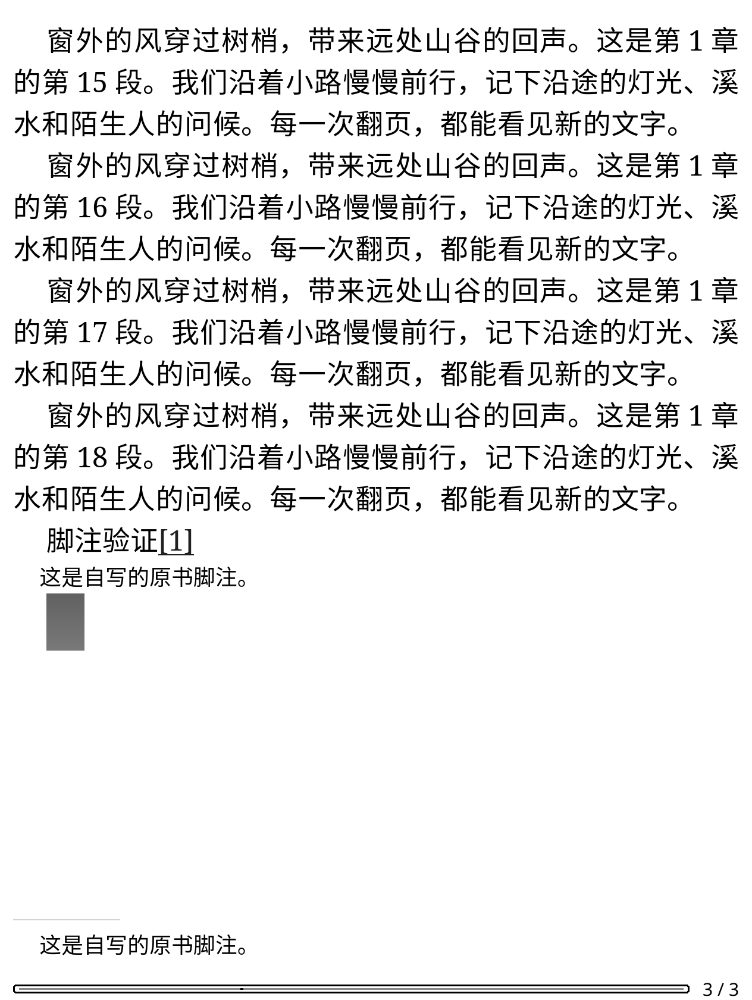
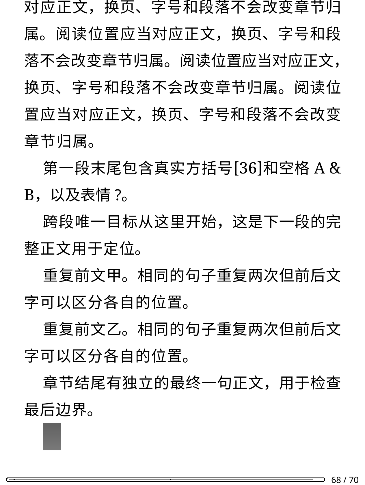
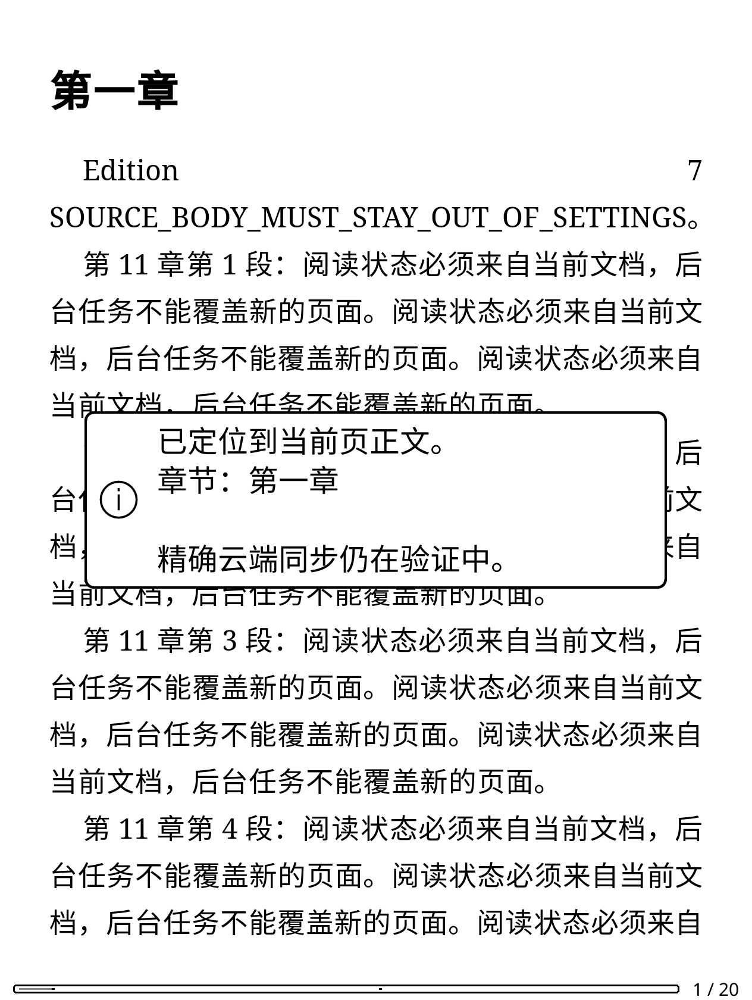
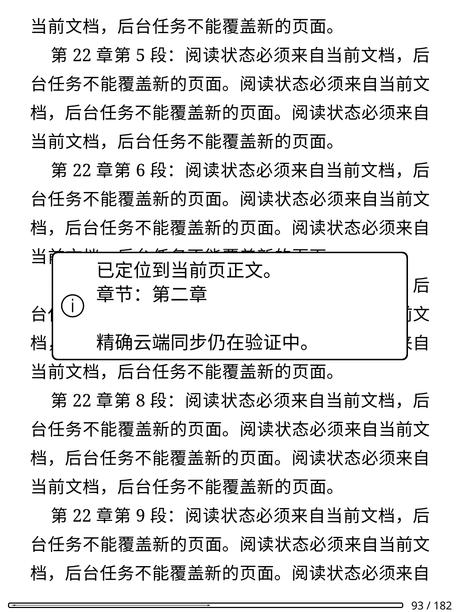

# 原文位置：公开页面与当前网页解析器验证

2026-11-10 更新：TXT 已增加独立的本地纯文本 UTF-16 映射、页面采集和原生反向跳转，
见[TXT 说明](txt-source-position.md)。下文各阶段关于 TXT 待处理的记录为此前验证边界；
TXT 云端坐标语义、精确上传和实体 KO2 仍未验证，不复用 XHTML 网页解析器结论。

当前自动上传仍使用目录字数和文档百分比。原文坐标转换、EPUB 原文绑定及章节 DOM 双向转换已实现；
ReaderUI 已接入当前页面的本地采集和后台准备，并提供“检查阅读位置”菜单。
已绑定当前 EPUB 的原文位置可通过内部本地导航入口跳转并保留目标；
后续新增的[云端只读原文适配](cloud-source-navigation.md)已提供手动菜单入口，要求正文与当前 EPUB 完全一致。
精确坐标作为独立本地快照，尚未替换上传字段或启用精确云端同步。
`scripts/verify_source_coordinates.py` 为下一步迁移准备 Python 原型，参考 MiuRead 的
`wr_co.lua`、`source_position.lua`，并在 2026-11-08 调用微信读书当前官方网页解析器核对。

## 实际证据与边界

初次 [去敏报告](validation-assets/2026-11-08/web-source-coordinates-public.json) 保留为 `PARTIAL`：

- 无登录读取一本书的公开预览，页面和三个正文分片均 HTTP 200。解码正文为 887 字节／774 个 UTF-16 单位，
  当前网页解析器生成的 67 个正文节点位置与原始坐标模型匹配。
- 另用合成正文验证常规标签、图片标签、引号、实体、换行、BOM 和补充平面字符。
  支持标签的组合样例核对 417 个节点；第一版原始坐标模型遇到改写标签时拒绝输出位置。
- 网页使用 UTF-16 位置，不能直接使用目录字数或 Lua UTF-8 字节数。表情会占两个单位；
  当前网页解析器将样例表情拆成两个替代字符节点。原型记录这两个节点，反向定位拒绝落在标量内部。
- 部分数字实体在当前网页中按字面显示，普通命名实体可以解码；CR 在 DOM 中变为 LF，
  但后续位置仍按原始长度推进。不能先解码实体／改换行，再将新下标冒充服务端位置。
- **原始 XHTML 坐标并不适用于所有标签。** 对 74 种标签分别调用当前解析器后，
  `a`、`figure`、`figcaption`、`q`、`rp`、`rt`、`ruby`、`samp`、`source`、`strike`、`summary`、`wbr`
  的正文位置出现差异。测试中忽略标签内的文字从该标签起点计数，后续正常段落又恢复其原始位置；
  简单删去这些标签后整体重新计数同样不匹配。脚本／样式或未知正文标签也不能直接套用原始下标。
  工具同时复验这 15 类反例，报告逐项记录原始模型和删标签模型均不匹配。
- 因此没有直接移植 MiuRead 的完整原始 XHTML 下标假设，也没有改变 Lua 上传位置。
  未验证真实账号的位置写入、回读或多设备行为。公开预览不能证明整本书、TXT 和所有 HTML 结构都适用。

浏览器使用新建的非持久会话，不读取日常浏览器设置。只允许微信读书站点和其 CDN 的 HTTPS GET；
后台 HTTP 写请求及其他来源均阻断，服务工作线程关闭，结束后关闭浏览器。
分片请求使用不带 Cookie 的独立客户端，只允许读者页和三个既有正文读取端点，不接受跳转。
正文、会话参数和原始节点仅在内存比较；报告只有状态、数量、摘要、公共资源 URL 和布尔值。
没有扫码、导入 Cookie、修改书架或上传进度／时长。

## 过滤后的计数规则与 Lua 核心

后续 [Python／Lua 对照报告](validation-assets/2026-11-08/web-source-coordinates-filtered-lua.json)
仍为 `PARTIAL`，但上述 15 类反例的转换规则已通过当前网页解析器核对：

- 白名单标签保留自己的原始位置；标签后文本从原始标签末尾开始计数。
- 两个保留标签之间，被忽略标签的文字拼接到同一段，忽略标签和注释的长度不计入这段。
  原有实体保持编码长度，文本中的裸角括号先转义。遇到下一个保留标签重新取其原始位置。
- 29 组公开／合成正文共 978 个网页节点与新模型匹配，包含原先无法用原始或整体删标签模型解释的 15 类反例。
- Python 随后将正文及查询通过内存输入交给官方 KOReader 的 Lua／JSON 环境。
  Lua 自行分词得到的文本段、规范化正文和 39 个局部定位结果与 Python 一致，且对应同一批实际网页节点。
  没有保存正文或凭据；这不是 ReaderUI 的跳转验收。

`weread/lib/source_coordinates.lua` 实现这套本地转换，支持 UTF-16、BOM、实体、前后文消歧和反向上下文。
每 256 个文本单元建立稀疏检查点，避免为整章每个字符保存一个 Lua 表；输入正文限制为 2 MiB，查询限制为 8 KiB。
79 项 Lua 检查覆盖实际观察的坐标、长章节跨检查点、重复／重叠句子、章节末尾上下文、
多字符实体、错误格式和反向歧义。角括号转义后，文本段可能覆盖下个标签的坐标区间；
一个云端坐标可能对应多个位置，此时拒绝反向定位，不选择第一处。

[合成压力结果](validation-assets/2026-11-08/source-coordinate-lua-benchmark.json) 验证了 1 MiB、2 MiB 正文及
2 MiB 裸角括号大量转义的情况，均完成构建和正反向查询。2 MiB 两例为 8192 个检查点；
不含源字符串的 GC 后 Lua 保留内存增量约 4.8／10.3 MiB，构建和查询 CPU 时间约 0.61／1.75 秒。
这是 Linux ARM64 容器结果，不是峰值 RSS 或 KO2 性能；后续接入须在后台准备，翻页不能同步重建整个索引。

上述坐标核心及本地 EPUB 原文绑定阶段未更改上传请求；后续 `ProgressSync` 仅加入独立本地快照，见下文。
仍须扩充 CREngine XPointer 对照并完成真实账号写后回读；短文本、纯图片、TXT、
扩展实体和包含复杂原始脚本／CDATA／多个 body 的来源也不能由本次结果宣称完成。

## EPUB 原文绑定与实际引擎验证

`weread/lib/position_source.lua` 在图片地址改写、脚注转换和 TXT 去空白之前截取准确原始字节。
下载工作区以 SHA-256 保存不可变原文和回执，整书完成检查点只引用同次下载的回执；晚到或未完成的
新原文不会替代旧检查点。损坏／缺失原文、重复／畸形回执会使该章重新下载。
旧缓存没有回执时仍可阅读，不能从残留文件或最新书库记录猜测原文来源。

EPUB 的 `OEBPS/weread-position/` 保存原文、按章节 UID 和渲染成员路径索引的两份一致元数据，
关联书 ID、章节、文件来源 ID、文件版本、原文摘要和实际渲染 XHTML 摘要。最终文件 ID 也纳入原文回执，
所以同版本、同渲染正文而原文字节不同仍产生不同文件 ID。版本仅表示文件下载时观察到的 metadata，
不是服务端签名或当前 Web 内容版本证明；不把原生书架 version 当作 Web 版本。

原始快照接口只使用已打开文档及其固定来源身份，不回退到磁盘同名文件或全局缓存。
后续后台读取则独立打开归档，并逐项核对父进程已固定的身份和元数据；同名替换不能通过这些核对。
原文暂存、整书回执扫描及 EPUB 打包已在下载后台执行。
完成后的父进程仅合并本次文件描述，保留其他并发缓存记录。原文上限 2 MiB、渲染章 8 MiB、元数据 4 KiB；
超限原文不提供精确定位来源。TXT 保留原始换行和尾空格，但未启用 TXT 坐标映射。

[两尺寸去敏报告](validation-assets/2026-11-08/epub-position-source.json) 来自最终候选 ZIP、
官方 KOReader v2026.07.1 Linux ARM64、Xvfb 的 600×800/167 DPI 和 KO2 1264×1680/300 DPI 灰度配置：

- 真正的 Client／HTTP、子进程下载器、图片下载、六章断点检查点、脚注转换和后台打包，之后由原生引擎逐章回读；
  六章均保留外部图片 URL 及原始脚注定义，与本地图片／已转换脚注独立关联。
- 段内唯一文本从原文映射到 `co=1395`，反向得到唯一上下文，逐 Unicode 标量行走并核对 DOM 文本前缀，
  原生 `GotoXPointer` 从第 1 页到第 3 页且目标可见。分页定位到包含目标的页面，不宣称页顶就是该坐标。
- 关闭图片下载时，同步范围下载两章及预取工作函数一章仍能保存并验证原文。
- 96 组 Lua 回归通过，其中原文绑定 36 项、断点内容 36 项；并发文档描述合并有专项检查。
  KO2 尺寸另外复验原生离线计时、旧文件版本 7／书库 99／同路径替换 8／重新打开绑定 8。

该轮跳转仅使用段内锚点：原生直接搜索不能匹配已去掉段落空白的跨段字符串。
后续章节 DOM 核心已补齐这一点，见下节；当前页面采集接线见“阅读器本地位置采集”。
测试没有连接生产账号、写入云端进度或证明 KO2 实体按键／网络／性能。



## 章节内原文与 DOM 双向转换

`weread/lib/source_dom.lua` 提供只读本地转换核心，不联网、不导航，也不执行全书搜索。
它读取本插件生成的 OPF spine，取得章节节点候选，并核对 CREngine 实际 `DocFragment` 的 `Source`
属性与 EPUB 元数据中绑定的成员路径。只在该章节的 DOM 文本内匹配，不使用书库标题、TOC 标题猜测或人工映射覆盖。
节点接口参照 [KOReader 的原生绑定](https://github.com/koreader/koreader-base/blob/master/cre.cpp)，
具体节点路径和行为在官方 v2026.07.1 运行时验证，缺少接口或来源属性时拒绝转换。

`locate(co)` 从原文得到唯一上下文，在章节中去除 Unicode 空白后匹配，按需反向行走到文字位置；
同时回读完整上下文及目标前缀，防止隐藏内容、生成文字、空白合并或 DOM 行走偏差产生错误位置。
`capture(xpointer)` 从章节前缀确认目标，再用原文上下文及 `locate_point()` 换算，最后反向核对可见位置。
`locate_point()` 经原始实体跨度与 UTF-16 单位换算，不能在原文坐标上直接加 Unicode 字符数。
原始 `[36]` 及 BOM 保留，不套用划线引文的清理规则；无法消歧或无法匹配时返回明确失败。

末章从已排版的最后一页按可见字符确认末端，不依赖最后一页存在单词；原生行走上限为 65536 步。
每 256 个新经过的字符最多保存一个原生 XPointer 检查点，不保留全章逐字符表；
重复、重叠查询不会不断增长已访问区域的索引。行走每 128 步检查取消并可协作让出执行，
文本规范化每约 16 KiB 也检查当前状态。取消、文件身份变化或行走不一致后，该索引不再复用。
生产调用者仍须提供绑定实际文档、账号和阅读代次的 `is_current`，并通过协程调度 `yield`。
该完整章节接口用于本地双向转换和独立对照；实时采集走后述局部上下文与独立后台归档，
不在翻页时调用完整章节接口。原生调用仍有同步部分，不能据此宣称 KO2 已无延迟。

[本机去敏报告](validation-assets/2026-11-08/source-dom-local.json) 验证：

- 两种灰度尺寸下，两章标题及正文完全相同，跨段目标分别落入正确章节；原生直接搜索该去空白上下文不能命中，
  章节 DOM 行走可以命中，选定可见字符点 `co=10785` 经原文 → DOM → 原文保持一致。
- 相同段落依靠前后文选择第二个实例；原始方括号、实体、表情、末章最后边界均验证；最后一页只有插图时也能确认之前的正文末端。
- 真正修改字号并改变分页后，以及切换滚动模式后，同一可见字符点仍回算一致；
  准备及实际行走时取消后，旧索引无法恢复，且定位过程不移动视口。
- 长章建立 39 个稀疏检查点，重复定位再走 91 步；这是该合成样例的检查次数，不是 KO2 性能或峰值内存指标。
- 合成 HTTP 实际下载的单章，以及带封面、图片改写、脚注转换的整书首章／末章，也完成原文与 DOM 回算。
  KO2 尺寸同时复验离线时长采集和文件版本替换；原有小数进度导航运行脚本回归通过。

公开只读解析器复验的 [独立报告](validation-assets/2026-11-08/web-source-coordinates-dom.json)
继续核对 29 组来源／978 个当前官方节点，另核对 39 个引文端点及 117 个引文内部标量边界。
纯 Lua 坐标核心现有 98 项检查、DOM 核心 46 项检查；总计 97 组 Lua、223 个文件静态检查和 71 组 Python 通过。

边界：去空白使多个原始空白位置可能对应同一个可见位置，不能宣称所有原始字节位置都可无损往返。
生产控制器还须保留刚从云端跳转的章内锚点，避免未翻页时把页顶位置写回为更早的进度；
实际当前页面采集、后台准备及文档／账号取消接线已在后续阶段验证；复杂生成内容和 TXT 仍待处理。
本核心没有改变上传请求，真实账号写后回读、多设备与实体 KO2 仍未验收。
KO2 尺寸截图中的表情显示为问号；本轮验证的是 DOM 文本坐标，尚未证明该字形显示完整。



## 阅读器本地位置采集

`source_position.lua` 现在连接真实 ReaderUI 的打开、翻页、滚动、账号切换、关闭和休眠回调。
页面稳定 0.3 秒后，`source_context.lua` 从原生当前页／滚动位置取得 XPointer，核对实际章节成员和文件元数据，
最多向前后各行走 192 个可见字符，每 64 步协作让出执行。当前选区存在时延后采集，
不移动阅读视口、不读取页脚缓存，也不序列化整章 DOM。上下文最多 8 KiB，只交给本次内存子进程。

`source_position_worker.lua` 使用独立归档描述符读取固定身份、路径元数据、原文及渲染章，
核对父进程固定的身份和元数据，并校验两份正文摘要后才构建坐标索引。
它不调用继承的 CREngine 文档；采集任务的结果通过最多 64 KiB 的内存管道返回，只有位置和有限元数据，
不返回正文、上下文或归档快照。原文坐标与上下文中的标量点必须唯一匹配并反向核对，无法匹配时拒绝猜测。
低内存、下载或预取忙碌会延后工作，最多重试三次；不转到界面线程执行原文解析。

每个结果绑定文档对象、路径、文件 ID、书籍、账号、阅读代次及当前页面／滚动位置，
并再次比较路径元数据。同书关闭重开、页面来回切换、同路径替换文件或切换账号后，旧结果不可复用。
休眠和关闭先取得已准备好的位置副本，再取消任务；现有同步配置及核验门槛仍决定是否保存待上传意图。
`ProgressSync` 仅增加 `source_position` 本地快照，现有协议构建明确忽略它，章内字数单位没有被原文坐标替换。

阅读菜单新增“检查阅读位置”。成功时显示从已核验渲染章读取的章节标题及云端同步待验证提示；
纯图片页、缺少原文的旧文件、来源改变、资源不足或匹配失败均给出提示。页面／账号状态变化时关闭旧提示。

[去敏运行报告](validation-assets/2026-11-08/source-position-live.json) 来自最终候选包和官方 KOReader v2026.07.1：

- 600×800/167 DPI 及 KO2 1264×1680/300 DPI 均验证真实后台子进程、当前页面采集、菜单提示和原生滚动；
  返回的坐标另经完整章节 DOM 接口独立核对。
- 任务执行中真实翻页、切换合成账号、关闭并打开其他书籍，旧子进程均取消并回收；
  另验证休眠／唤醒回调、低内存恢复、版本 7 的打开文档拒绝同路径版本 8，重新打开才绑定版本 8。
- 正文 canary 未进入设置文件，工作结果仅保留允许的元数据字段；章节标题来自已核验的文件。
- KO2 尺寸回归实际 HTTP 下载、图片／脚注转换、六章后台打包、原生离线统计及文件版本固定流程。
  这些 HTTP 数据为本地合成数据，没有生产账号写入。
- 100 组 Lua、233 文件静态检查零警告及 71 组 Python 测试通过；新增页面采集 13 项、工作任务 30 项、
  会话控制 41 项、进度控制 175 项和上报边界 20 项检查。

[独立归档边界报告](validation-assets/2026-11-08/source-archive-boundaries.json) 使用真实 libarchive，
验证正常／空成员／5000 个额外头，以及重复目标、超限、缺失、正文中截断和链接成员共 8 例。
20 次连续读取后文件描述符仍为 4 个；接口不提取文件到磁盘。此结果不代表所有 ZIP 结构损坏都已覆盖。

仍待：精确原文目标跳转后尚未翻页时的锚点保留、精确坐标的上传及独立回读、复杂生成内容／TXT、
多设备冲突和 KO2 真机的性能、实体键、网络及休眠验收。合成样例的本地转换不证明真实服务端坐标可直接写入。



## 现有云端目标的保留

当前按目录字数／百分比映射的生产路径也需要保留刚选择的云端目标。
例如合成 602 页 EPUB 中，目标章内位置为 60921；跳转落在第 122 页，该页起点回算为 60797。
若立即用页顶覆盖目标，即使尚未继续阅读，下一次上报也会倒退 124 个单位。
此修正保留的是现有模型的目标，不把这些单位改称原文 UTF-16 坐标。

`ProgressSync` 现在以文档对象、账号、阅读代次、路径和原生视口绑定选定目标。
同页重绘、延迟采集及短暂休眠没有移动时，继续使用该目标；实际翻页／滚动、
原生同页跳转、切换账号、关书或重开使它失效，返回原位置也不会恢复旧目标。
原生 `PosUpdate` 同样更新进度和移动状态。现有章节偏移直接保留，避免百分比往返换算少一个单位，
也避免章节结尾被回算成下一章开头；跨章打开期间保留相同的偏移。

字体、页边距及分页／滚动模式切换可能产生多个中间视口，甚至到绘制时才恢复原生位置。
仅在原生导航锚点未变、原来的文字位置仍可见时允许重排；连续两次稳定视口后重设移动基线，
每次间隔 0.1 秒、最多观察四次。真实导航锚点变化会立即拒绝旧目标，休眠中停止观察，
迟到的布局任务不能恢复已失效的目标。无法核验时恢复普通当前位置采集，同时撤销本次进度确认，重新核对前不上传猜测位置。

保留的逻辑进度与实际 `viewport_fraction` 分开记录；本地保留标识和视口元数据不进入上报协议。
选择云端后尚未阅读就关书，不产生页顶位置的反向上传；配置开关、冲突核验与精确坐标上传门槛继续生效。

[两尺寸运行报告](validation-assets/2026-11-08/remote-target-retention.json) 核对真实 ReaderUI、原生排版和事件：
第 122 页目标、字号变化使 602 页变为 706 页、滚动模式、相邻字符的同页原生跳转、返回不复活，
以及后续真实滚动使保留目标失效。另回归本地原文定位、实际后台进程、账号／休眠取消、
完整 HTTP 下载、图片／脚注、断点打包、原生离线计时及同路径文件替换。
进度控制组件 227 项、原生视口组件 38 项和上报边界 22 项检查通过。

该修正没有新增微信读书接口或启用精确坐标写入。后续仍须把经过验证的云端原文目标接入
精确 DOM 跳转和保留流程，并完成真实账号写后回读、多设备、复杂内容及 KO2 真机验收。

## 已绑定原文的本地精确跳转

`source_navigation.lua` 及插件内部 `openSourcePosition(position, callback)` 已接入实际 ReaderUI。
输入必须带本书、章节、原文 `co`、文件 ID、文件版本、原文摘要、渲染成员路径及明确的原文坐标类型。
目录字数位置、其他文件／版本或缺少来源的数据直接拒绝，不能从裸云端偏移推断这些字段。
该入口尚未接到云端位置适配器，未增加用户菜单或改变上传单位。

后台独立读取当前路径的归档，逐项核对父进程固定的身份和元数据、原始／渲染正文摘要，再生成唯一原文锚点。
导航任务只通过内存管道传递一个最多 8 KiB 的临时定位文本及有限元数据；该文本不写入设置、日志、数据库或报告，
也不保留在完成／取消后的任务里。采集任务仍只返回位置元数据。两种任务都不使用继承的原生文档。

父进程使用 `source_dom.open_prepared()`，只接受匹配的章节来源，核对原生 `DocFragment Source` 与 spine 后定位。
该路径不从原生归档接口读取原文或渲染章，也不在界面线程重新解析原文坐标；完整定位文本和精确前缀均须匹配。
原生字符行走每 128 步检查阅读代次，调度按约 20 ms 的活动时间片让出，避免每个小批次都额外等待 0.1 秒。
原生跳转后再次检查目标确实可见，才把位置绑定为本次保留目标。准备和行走过程中有账号、文档对象、路径、
文件身份、元数据、页面／滚动位置及超时约束；低资源最多延后三次，整次任务超过 120 秒取消。

精确原文目标与现有字数目标分别保存，复用已验证的布局稳定检查。字号和模式变化保留同一个原文 `co`；
真实移动、同页相邻字符跳转、关闭／重开或账号变更均使旧目标失效。原生同一行跳转可能不发出位置事件，
查询发现旧目标失效时会安排一次有界的当前位置重新采集，不从旧结果缓存复活该目标。
应用新的常规云端目标前也会取消尚未完成的本地原文跳转，清除旧原文保留目标。

[本地导航报告](validation-assets/2026-11-08/source-navigation-local.json) 记录两种尺寸的最终候选包：

- 两章各 450 段的合成整书，从第 1 页跳到第二章的原文 `co=741`；所在页起点在 600 尺寸为 `co=435`、KO2 尺寸为 `co=433`。
  目标保留的是 741；实际改字号、切换滚动模式及同页跳转后的失效均通过。
- 定位时观察到独立子进程和父进程定时回调；原生文档接口均留在父进程。
  父进程读取原文／渲染归档成员会使测试直接失败；后台准备中和实际原生反向行走中都用真实翻页取消。
- 真实关闭／同路径重开取消目标准备子进程，不执行迟到跳转；账号切换、低内存恢复、替换文件及另一书籍切换回归通过。
- 实际 HTTP 下载的单章、图片／脚注转换后文件也通过生产导航入口到 `co=1395` 并保留；
  旧章节 DOM、纯图片末页、原有常规云端目标保留、整本打包和原生离线统计回归通过。
- 101 组 Lua、236 文件静态检查零警告、71 组 Python；导航控制 31 项、原文工作任务 50 项、
  页面采集 15 项、原文采集会话 50 项、章节 DOM 55 项、进度控制 238 项及原生视口 43 项检查通过。

仍有限制：OPF 扫描和单章 DOM 文本提取包含同步操作，原生文本上限 8 MiB；事件循环回调不等于峰值内存、
最大章节耗时或实体 KO2 性能验收。TXT、复杂生成内容和既有表情字形问题仍待处理。
云端原文目标的真实只读比对、版本语义、精确写入／独立回读、导航操作协调及多设备验证尚未完成；
本次本地跳转不会授予进度上传确认，`upload_verified` 保持 false。



## 章节目标交接与操作顺序

实际 ReaderUI 切换章节会重建插件，不能只在旧 ProgressSync 中保留待跳转目标。
`chapter_handoff` 使用原生打开后回调，核对旧请求、一次关书代次、账号、目标路径及新阅读器的书籍身份后，
将有界目标交给新控制器一次。新控制器按实际单章／整书上下文重新计算现有映射，目标不写入设置。
原文导航请求同时撤销旧云端比较和待切章操作；旧确认框、下载结果及延迟打开不能覆盖新请求。
被替代的下载允许完成缓存，有效下载则在任务清理后切换阅读器。

[两尺寸真实运行结果](validation-assets/2026-11-08/navigation-intent-local.json) 覆盖实际插件重建、
原生确认框、HTTP 下载中发起新原文请求以及新下载后的再次切章。
两次有效跨实例交接均保留第二章现有映射的偏移 154；102 组 Lua、238 文件零警告、71 组 Python 通过。
这不替代云端原文目标适配或版本验证，也不证明现有字数模型中的偏移就是原文 `co`。

## 复验

默认只做离线边界检查，不联网，不需要浏览器依赖：

```sh
python3 scripts/verify_source_coordinates.py
python3 scripts/test_source_coordinates.py
```

23 组离线检查覆盖 UTF-16／BOM、标量内部拒绝、实体原始跨度、正文边界、标签拒绝、重复及重叠文本、
前后文消歧、不可匹配拒绝、网页表情替代字符、数字实体字面显示、请求范围及默认命令不联网。
另覆盖过滤后文本段、重设位置、嵌套／自闭合标签、角括号展开、注释移除、坐标歧义及 Lua 比较结果核验。
已纳入 CI；测试不启用真实浏览器或访问账号。

公开页面与实际官方解析器复验需要单独的 Python 环境、Playwright 和系统 Chrome：

```sh
python3 -m venv /path/to/source-position-tools
/path/to/source-position-tools/bin/python -m pip install playwright
/path/to/source-position-tools/bin/python scripts/verify_source_coordinates.py \
  --public --book-id 3300237584 --output /path/to/new-coordinate-report.json
```

本次使用外层 `.validation/source-position-tools/`、Playwright 1.64.1、Chrome 157.0.8103.39。
官方脚本的公共资源路径保存在报告中；查找已加载解析器的导出契约，未硬编码模块编号。
官方模块导出、已支持样例或反例行为变化会停止，不以旧实现的测试结果代替新解析器核对。

使用当前工作区的只读容器和真实 KOReader 核对 Lua（命令参数必须放在最后）：

```sh
/path/to/source-position-tools/bin/python scripts/verify_source_coordinates.py \
  --public --book-id 3300237584 --output /path/to/new-lua-coordinate-report.json \
  --lua-command docker exec -i -w /validation/runtime/lib/koreader \
  weread-validation ./luajit /source/spec/koreader/source_coordinate_probe.lua /source
```

正文及查询只走标准输入／输出内存管道，报告不包含它们；核验失败只报告受控原因，不回显子进程输出。


有真实 KOReader 运行时的本地 DOM 复验（使用新目录，不联网到生产服务）：

```sh
xvfb-run -a python3 scripts/test_position_runtime.py --probe source-dom \
  --koreader /absolute/path/to/koreader --run-dir /absolute/path/to/new-run \
  --width 1264 --height 1680 --dpi 300
```

省略 `--probe source-dom` 时，仍运行原有小数进度导航验证。

跨阅读器章节交接、原生提示和实际本地 HTTP 下载协调使用新目录：

```sh
xvfb-run -a python3 scripts/test_position_runtime.py --probe navigation \
  --koreader /absolute/path/to/koreader --run-dir /absolute/path/to/new-navigation-run \
  --width 1264 --height 1680 --dpi 300
```

实时本地位置与独立归档边界使用两个新目录分别复验：

```sh
xvfb-run -a python3 scripts/test_position_runtime.py --probe source-state \
  --koreader /absolute/path/to/koreader --run-dir /absolute/path/to/new-live-run \
  --width 1264 --height 1680 --dpi 300
python3 scripts/test_source_archive_runtime.py \
  --koreader /absolute/path/to/koreader --run-dir /absolute/path/to/new-archive-run
```


## 继续接入所需工作

### 真实账号的只读前置核对

`scripts/verify_web_source_progress.py` 默认只运行离线检查，不联网，也不读取设备设置或日常浏览器凭据。
交互模式默认仅在内存中保留登录和原文，退出后清理进程 Cookie 和临时二维码。
它不复用包含写入测试分支的 `verify_progress_sync.py`。
默认不持久化凭证。显式 `--save-session` 在账号核验后立即保存到本机 macOS 钥匙串，并回读校验；
后续 `--saved-session` 每次重新核对账号，不读取日常浏览器凭据。目标未完成时保留该项目条目，
最终验收收尾或主动撤销授权时用 `--clear-saved-session` 删除。原文始终只在内存中，不写入钥匙串或文件。

```sh
python3 scripts/verify_web_source_progress.py
# 需要本机 qrcode 依赖，并由账号本人扫码；报告路径必须尚不存在。
python3 scripts/verify_web_source_progress.py --interactive --book-id 3300237584 \
  --output /absolute/path/to/new-read-only-report.json
# 明确允许保留本轮开发凭证时，扫码成功后保存；只读选择最多八本已有书籍中的有效位置。
python3 scripts/verify_web_source_progress.py --interactive --save-session --select-shelf-book \
  --output /absolute/path/to/new-saved-login-report.json
# 后续验证复用钥匙串；可选安装 Playwright／Chrome 核对当前官方解析器。
python3 scripts/verify_web_source_progress.py --saved-session --select-shelf-book --official-parser \
  --output /absolute/path/to/new-official-parser-report.json
# 整体目标验收收尾时执行；开发验证期间不自动删除。
python3 scripts/verify_web_source_progress.py --clear-saved-session
```

交互流程读取指定书籍的云端位置、同章网页状态、目录及原始正文分片，再读取目录和云端位置。
仅允许固定域名和读取端点；目录和三个正文分片使用已有的 POST 读取，其余均为 GET。
进度／时长／书架／批注写入及续期端点不在允许范围内，跳转也不跟随。
账号、书籍和章节必须匹配，超限响应拒绝，读取期间位置或目录改变不会记作稳定比对。
零点、空白、表情标量内部及重复文本的坐标不能通过向后猜测得到正文位置。
书架选择通过已实测的 Web `/web/shelf/sync`，不需要官方接口密钥。
零章节／零位置的占位数据不猜作第一章；只跳过明确未读或没有位置的候选，错误书籍响应立即停止。

报告只包含受控阶段、状态、数量及比较结果，不包含账号／书籍标识、位置值、正文、会话参数或登录链接。
即使两次位置一致且本地模型能反查，也仍保留 `PARTIAL`，不宣称坐标含义或服务端版本语义已证明。
23 组只读流程、11 组安全保存边界及 5 组浏览器隔离检查通过；本工具没有接入 Lua 或开启精确云端上传。
匿名登录页面与会话 UID 已以两个固定 GET 实测为 HTTP 200；未登录账号，不将出票成功当作位置验证通过。

后续真实扫码、钥匙串保存／跨进程复用及账号回读通过，Web 书架回读 139 本。
[实际账号去敏结果](validation-assets/2026-11-08/web-source-owner-readonly.json) 记录一个已读样本：
云端前后位置与网页位置一致，目录稳定，原文可唯一反查；当前官方解析器的 11,430 个节点通过核对，目标节点存在。
Lua 的完整文本段和规范化文本与 Python 相同，另核对 3 个引文、9 个内部标量边界及当前云端目标的双向转换。
私有原文进入全新匿名浏览器前已关闭网络、阻断 HTTP 和 WebSocket；不在浏览器中安装账号 Cookie。
可选 `--lua-command` 必须放最后，原文仅经本机进程的标准输入／输出内存管道核对，不回显内容。

实际核对发现网页在部分标点间插入 U+200B 断行标记，合成最小例子是原文 `）；` 对应节点 `）\u200b；`。
验证器仅允许额外的浏览器标记，不跳过原文单元、不移动坐标，也不接受只有生成标记的节点。
修复后另完成公开的 30 组来源／1,000 个节点、40 个引文与 120 个内部标量边界复验。
实际样本含 32 个生成标记节点；没有将标记加入 Lua 原文模型。

以上仍为单本只读观察：目录只观察到 `book.version`，尚未证明与网页版本的对应含义。
原文云端目标适配、精确写后回读、多设备与实体 KO2 均未完成，保留 `PARTIAL`。

### 后续步骤

1. 常用标签过滤模型及 Lua 核心已完成；继续核对复杂格式、短章／图片／脚注和 TXT，保留反例与反向歧义检查。
2. 原始坐标来源与打开 EPUB 的章节、文件版本和正文摘要绑定已完成；继续核对真实 Web 内容版本含义，
   不能从文件 metadata 推断当前服务端版本。
3. 跨段／重复上下文、章节资源归属、双向转换、字号／滚动和取消核心已验证；ReaderUI 实际当前位置、
   后台准备及账号／阅读会话生命周期已接入本地采集。本地原文目标的精确跳转和未翻页保留已接入；继续验证云端目标适配，并补齐复杂内容及真机覆盖。
4. 单本真实只读位置对照已完成；继续核对版本含义和适配，再验证明确授权的一次进度写入与独立回读；多设备和实体 KO2 另行验收。

以上仍是原始目标中未完成的精确进度工作，不将本原型的局部验证记作插件功能已完成。

## 2026-11-10 本机原文位置的上传候选准备

`SourcePosition:prepare_upload_preview(callback)` 已接入正常插件实例，使用现有实时采集结果，
不再由工具替正常页面猜测偏移。它只准备候选，不调用网络、持久化或实际上传服务。
一个独立后台工作进程重新打开归档，核对来源、文件、章节、版本和原始／渲染正文哈希，
再由已核验的原文坐标取得最多二十个 Unicode 标量的摘要，完整保留表情并解码实体。
摘要对应原文模型的规范化可见文本，不用 UTF-8 字节截断，也不把单词数或字符数加到源偏移上。

目录必须唯一匹配实际源章节 UID，且明确提供无矛盾的章节序号，合法零序号保留；
不能按整书百分比或字数猜当前章节。百分比沿用捕获时现有显示投影的整数，
不以 XHTML 偏移除以目录字数重新计算；这不是服务端百分比语义验证。
目前只为 `filtered_xhtml_utf16` 准备候选，TXT 本地定位继续可用，但不据此取得云端上传单位。

返回结果仍为 `upload_verified=false`，只经内存回调交给显式调用者；`current()`、
状态通知和本机检查点均不包含候选或摘要，现有 `capture_local()` 的外层单位和实际上报保持原状。
回调前重新核对文档、账号、文件、位置、原文元数据、目录序号及百分比。
目录直接重新查询本机当前保存的数据，不复用普通同步帧中已缓存的旧目录。
换页／换书／休眠／关书撤销任务，迟到结果不能提交；同页精确目标改变也会失效。
显式取消还覆盖“正在等待原文采集，尚未启动候选工作进程”的阶段。
候选未被缓存在服务或持久记录中；来源变更和资源不足不会回退到 UI 线程解析正文。

独立 Python 原型先在两个真实原文位置通过，再与 Lua 后台内核经捕获管道逐字段核对。
Lua 输入没有凭据或预期答案，正文和完整候选不进入报告／普通文件；真实进度及授权写入均为零。
该项只证明真实原文模型，不是本人账号在原生阅读器中生成候选的完整验收。

官方 KOReader v2026.07.1 Linux ARM64／Xvfb 的两尺寸合成验收各核对十份候选，
覆盖初始页面、翻页、滚动、精确保留目标、文件重开和切书，摘要逐项对照实际原生 DOM。
真实工作进程在页面移动后取消并回收，等待采集时的显式取消不再启动候选任务。
TXT 两尺寸保留原文定位、导航和生命周期检查，但候选明确返回不支持。
四份候选包各 190 个生产文件与源码／安装目录一致、ZIP 完整，重绘错误为零。
49 项新 Lua 候选／生命周期检查及一项 TXT 内核反例、10 项 Python 模型／隐私检查通过；
完整 168 组 Lua、562 项 Python、441 个静态文件、443 个 Lua 语法文件及既有检查通过。

结果见[固定字段证据](validation-assets/2026-11-10/source-upload-candidate.json)。
下一步仍需本人账号的正常采集器到候选的组合核对、服务端当前内容版本核对、
限定实际写后回读及最终上传适配；不能只因候选已准备好就开启自动上传。
多设备、更多格式、实体 KO2 和完整功能验收后的集中性能优化仍待完成。

```sh
python3 scripts/verify_source_upload_candidate.py
python3 scripts/test_source_upload_candidate.py
python3 scripts/verify_source_upload_candidate.py --saved-session --lua-command \
  docker exec -i -w /validation/runtime/lib/koreader weread-validation \
  ./luajit /source/spec/koreader/source_upload_candidate_probe.lua /source
```
