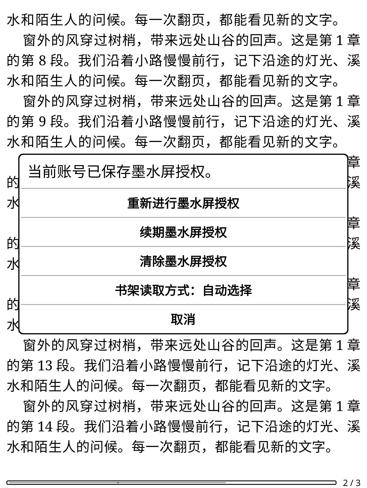
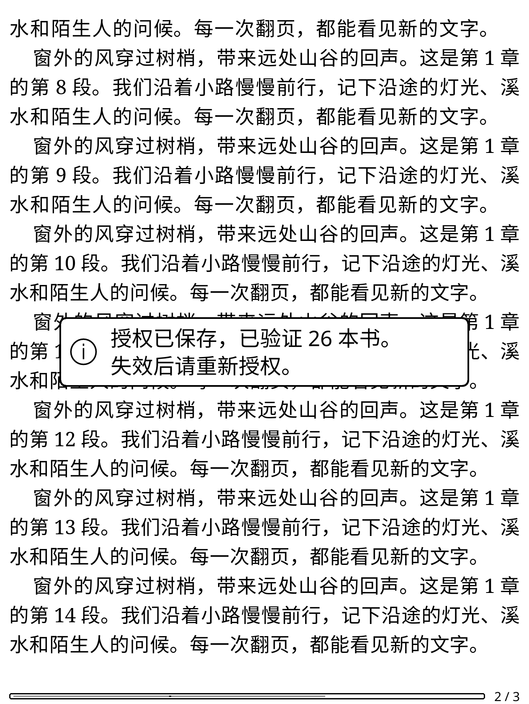
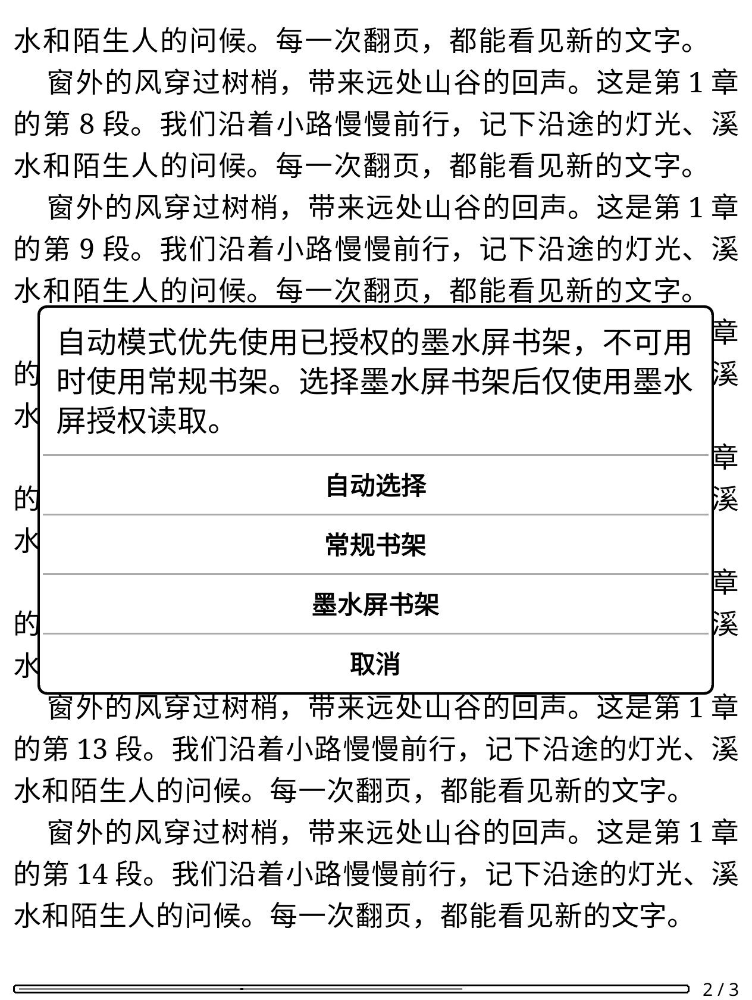
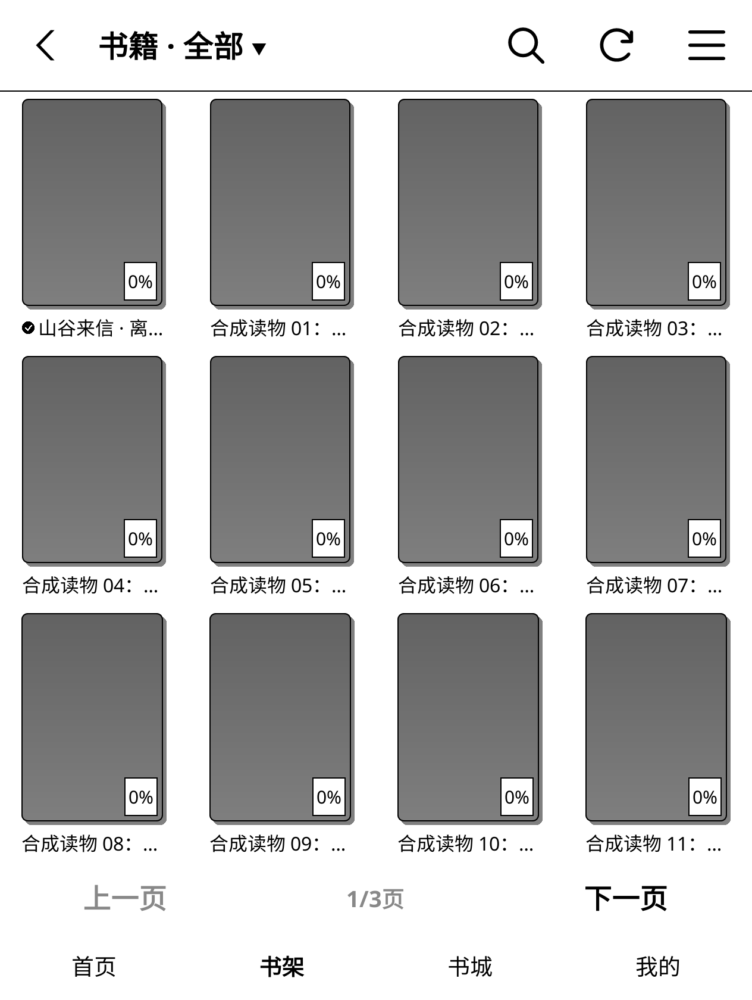
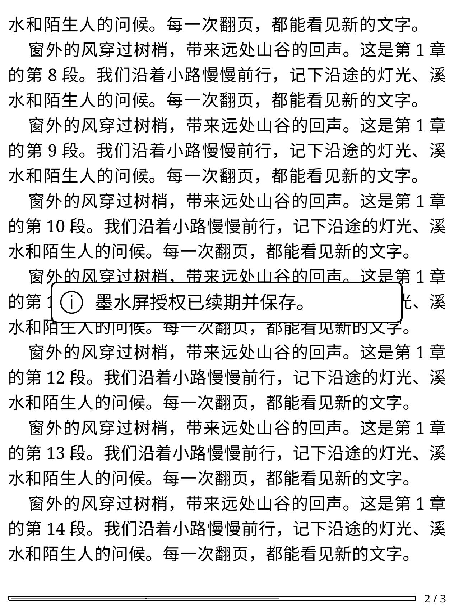
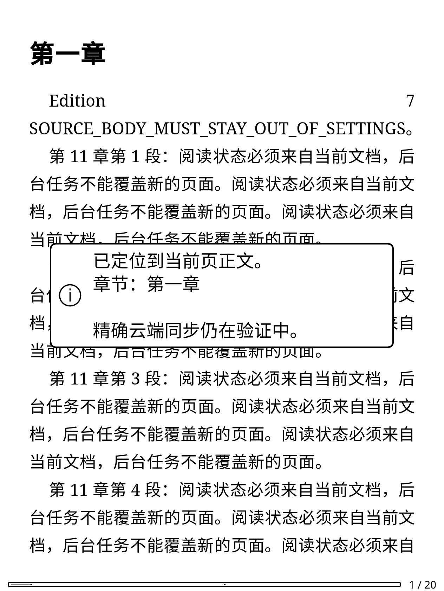
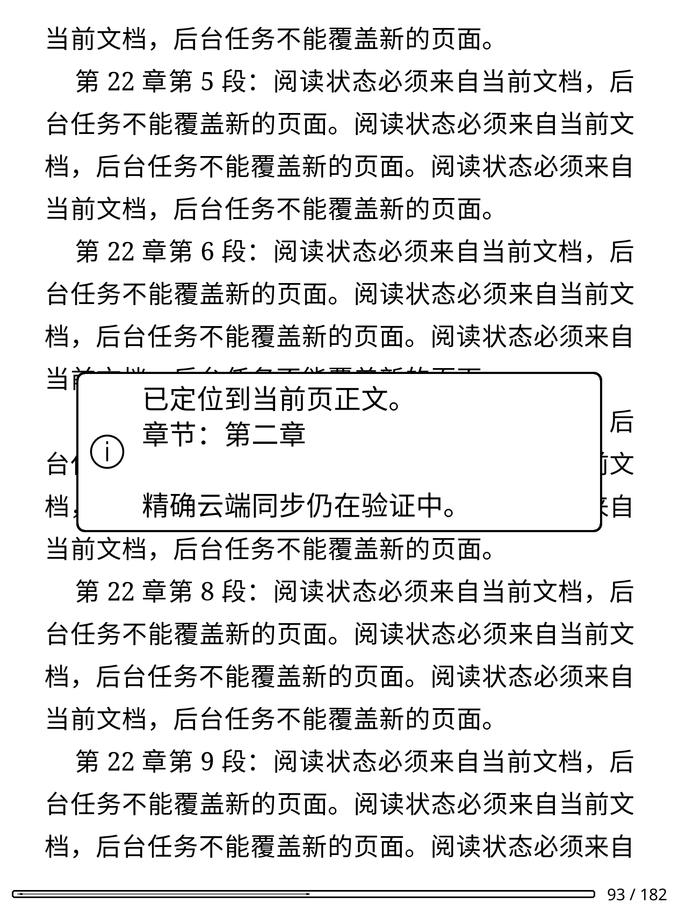
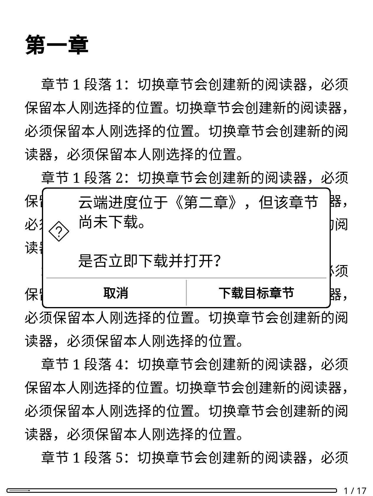

# 2026-11-08 开发阶段验证

本记录对应开发分支的独立更新通道和真实运行环境建设，不是正式发布验收。
剩余功能见 [开发清单](development-roadmap.md)。

## 实现与修正

- 更新元数据和安装包只从 `szxypi/weread.koplugin` 获取。
- 清除旧仓库的缓存更新信息；下载包及校验文件必须匹配本仓库和目标版本。
- 本仓库尚无正式 Release，GitHub 返回 404 时提示“尚未发布”，不当作普通网络故障。
- 修复首页与书城标题显示为禁用灰色的问题。
- 新增真实运行脚本；原有阅读与更新脚本不再依赖发行包没有包含的单元测试框架。

## 实际执行结果

| 项目 | 结果与覆盖范围 |
| --- | --- |
| Lua 单元／组件回归 | PASS：101 组，包括已绑定原文的精确跳转、保留／取消及本地页面定位／后台会话、章节 DOM 双向定位、EPUB 原文绑定／回执与原文坐标核心、续期／待确认标记、书架通道、授权界面／保存回读／后台管道、错误去敏、阅读同步、更新与失败恢复 |
| Luacheck | PASS：236 文件，0 警告、0 错误 |
| 命名空间、Python 编译、差异格式 | PASS |
| Python 合成 HTTP 测试 | PASS：9 组；另有授权原型 5 组、续期原型 8 组、书架写入原型 14 组、补传只读前置 12 组，另有原文坐标 23 组，共 71 组 |
| 真实插件初始化 | PASS：官方 KOReader v2026.07.1、真实控件／字体／SQLite |
| 首页／书架／书城 | PASS：候选 ZIP 安装后，空页面、最近阅读、分页、列表／封面切换、搜索／推荐、关闭和账号清理 |
| 三种显示配置 | PASS：600×800/167 DPI、800×600/167 DPI、1072×1448/300 DPI，原生 BB8 灰度模拟 |
| 本地合成 HTTP + 真实 Lua Client | PASS：推荐首批与末批、搜索、书架、封面下载及缩略图缓存 |
| 阅读主链路 | PASS：真实 PluginLoader → Client/Content → EPUB → ReaderUI → 第二页 |
| 整本下载 | PASS：真实后台下载器与事件循环；六章正文、图片和脚注；ZIP 与章节完整性检查 |
| 更新主链路 | PASS：真实子进程、说明滚动、固定按钮、提醒持久化、SHA-256 失败拒绝、重试安装和旧目录备份 |
| 真实账号读写 | PARTIAL：E-Ink 扫码、登录、两次续期及书架／配置／位置读取通过；账号数据写入未执行 |
| Kindle 硬件 | 未执行：尚无连接设备；残影、真实触摸、按键、休眠与耗电仍待验证 |

界面测试通过控件回调执行操作，不等于对每个触摸坐标、手势或按键完成端到端验收。
合成 HTTP 服务器不会转发到微信读书，故不能证明线上接口当下仍接受相同请求。
更新测试替换 HTTP 读取边界为本地包，真实执行其余下载后的校验和安装步骤。

## 环境与复验

主机通过 OrbStack 运行 `weread-validation` 容器，基础镜像为 Ubuntu 24.04 ARM64。
使用官方 `koreader-linux-arm64-v2026.07.1.tar.xz`，未从源代码重新构建。
安装包、隔离设置、请求日志、截图及运行日志位于项目外层 `.validation/`：

- `bw-600/`、`bw-landscape/`、`bw-large/`：灰度页面验证。
- `reader-core/`：阅读、翻页与整本下载验证。
- `updater-candidate/`：更新安装与恢复验证。

Linux 环境依赖 SDL、Xvfb、xauth、zip/unzip、Python 3 和 git。
容器中的源码挂载为只读；测试只写独立目录，不访问日常阅读配置。

```sh
xvfb-run -a python3 scripts/test_discovery_runtime.py \
  --koreader /path/to/runtime --run-dir /path/to/new-discovery-run
xvfb-run -a python3 scripts/mock_weread.py --smoke --port 0 \
  --koreader /path/to/runtime --run-dir /path/to/new-reader-run
xvfb-run -a python3 scripts/test_updater_simulator.py \
  --koreader /path/to/runtime --run-dir /path/to/new-updater-run
```

## 实际截图

本人扫码授权与 Lua 协议迁移后续验证：

- 本人完成微信扫码后，实际登录、书架、config、feature 和当前位置均 HTTP 200。
  书架返回 139 条图书记录，位置字段和阅读秒数字段存在；只保存字段名、类型和数量，
  见 [已授权只读结果](validation-assets/2026-11-08/eink-authenticated-readonly.json)。
  二维码已删除，验证进程已退出；没有保存凭据、修改书架或上传时长。
- 在此实际验证后迁移 Lua 授权协议核心。89 组 Lua、Luacheck 201 文件零警告、
  9 组 HTTP、5 组授权原型、12 组补传只读测试通过。协议核心含 109 项检查，
  HTTP 组件含 62 项检查，原有 Web 登录组件含 63 项检查。
- 核心覆盖账号不匹配、取消、失效、跳转拒绝、响应体上限、签名、字段校验、凭据去敏、
  登录请求不重放以及书架回读重试。敏感诊断同时保护原有 Web 登录的错误响应和异常。
- `.validation/native-authorization-core-ko2/` 使用候选包、真实 KOReader Client／JSON／随机源和合成 HTTP，
  Python 服务独立检查 Lua 生成的登录签名，再回读合成书架。日志中没有二维码会话、授权码或凭据。
  同时通过原有阅读、账号／休眠取消、离线计时、覆盖日志、文件替换和整本下载回归。
- `.validation/native-authorization-final-600/` 和 `.validation/native-authorization-final-ko2/` 为加入
  发送前失败可恢复及原有 Web 登录去敏后的最终候选包复验，两种显示配置均通过。
- 后续新增“墨水屏授权”菜单，扫码／重新授权／清除均已接入。主登录继续使用 Web；
  墨水屏扫码限定同一账号，绑定当前登录代次，普通 Cookie 续期不使授权失效。
- 请求在后台进程运行，结果仅通过最多 64 KiB 内存管道返回，不创建含凭据的工作文件。
  立即取消也终止尚未建立进程组的子进程；关闭二维码、账号切换、休眠和关书停止授权。
- 独立有界文件保存凭据，写后读取主文件核对；损坏主文件不退回旧备份，较早修订不能覆盖新授权。
  保存失败可仅重试保存，书架失败仅重试读取，可能已发送的登录不重用授权码。
- 新增组件覆盖文件读取／写入失败、取消、失效／账号不匹配、迟到结果、同账号同秒重登及 Cookie 续期。
  `.validation/native-ui-verified-600/` 与 `.validation/native-ui-verified-ko2/` 使用最终候选包验证真实菜单、
  QRMessage、后台调度、25 KiB 管道、立即取消、LuaSettings 保存、新实例回读及清除，原阅读／下载／
  12 秒离线采集／覆盖日志回归同样通过。首次运行发现的子进程回调参数适配已修复并重新验证。
- 本轮界面和持久化只用合成账号；本人扫码得到的真实凭据未保存。后续续期结果见下方，实体 KO2 完整扫码仍待验收。





## 墨水屏书架与读取方式

- 新增“自动选择／常规书架／墨水屏书架”，选择保存后读取主文件核对，失败回退原选择。
  自动模式优先使用当前授权，原生读取失败只尝试一次常规接口并提示；强制墨水屏模式不切换来源。
- 复用已经本人扫码及 Python 验证的 GET `/shelf/sync`，没有新增未验证的原生接口。
  墨水屏列表／封面和分组进入现有 SQLite／展示流程；无官方 API Key 时也能刷新墨水屏书架。
  正文、书城、进度等接口继续使用原有通道。
- 无效原生快照不替换缓存。原生 `version` 仅另存元数据，不成为 Web `bookVersion` 或文件来源版本。
  组件覆盖自动／强制来源、失败回退、账号／授权／方式变化、异常快照、空书架及请求头隔离。
- 两种书架刷新均使用可取消的后台进程和有界内存管道；旧账号、页面或授权回执不能写入缓存，
  旧回执也不能取消新任务。清除原生授权后自动读取常规书架的路径已专门回归。
- `.validation/native-shelf-ready-600/` 与 `.validation/native-shelf-ready-ko2/`：
  最终候选包通过实际菜单选择／保存回读、列表与封面、三个分组、原生版本 700／Web 版本 7 隔离、
  无官方密钥读取、401 不切换／自动回退、缓存保留、刷新弹窗取消和清除后普通刷新。
  150000 字节后台结果通过实际管道，覆盖超过授权管道容量的书架结果。
  覆盖完整封面加载及固定导航边界。测试启动器显式使用 BB8 灰度缓冲，记录显示配置。
  原账号／休眠同步、离线采集、覆盖日志、EPUB 来源及整本下载回归仍通过。
- `.validation/native-shelf-discovery-ko2/`：原首页／书架进度／书城／我的完整绘制、后台、原生按钮与账号清理回归通过。
  上述使用合成数据及回调交互；实体 KO2、真实账号的插件内展示、触摸／按键和网络仍待验收。





## 原文坐标：首次公开解析器核对

- 新增 Python 原型及 13 组离线检查，默认不联网，已纳入 CI。
- 公开预览页及三个正文分片均 HTTP 200，原始内容为 887 字节／774 个 UTF-16 单位；
  当前官方解析器的 67 个正文节点位置匹配。常规标签组合另核对 417 个合成节点。
- 真实调用发现表情拆分、数字实体字面显示及换行差异；另有 12 种标签（包括链接）使正文坐标偏离
  直接的原始 XHTML 下标，整体删标签再计数也不能解决。原型拒绝这类来源，反例保留为后续迁移依据。
- 浏览器使用无账号的新会话，阻断非 GET、第三方请求及服务工作线程；独立无 Cookie 客户端只读公开正文。
  没有执行账号数据写入。报告保留 `PARTIAL`，没有据此更改 Lua 上传位置或宣称完整映射完成。
- [去敏结果](validation-assets/2026-11-08/web-source-coordinates-public.json) 与
  [复验／继续接入清单](source-position-prototype.md) 记录范围及未完成项；本次只增加验证工具和文档，插件运行代码未改变。

## 过滤后坐标与 Lua 核心

- 在前述反例基础上，核对当前网页的过滤／分段流程：忽略标签和注释不计入相邻文本段，
  保留标签重设原始基点；实体及角括号转义按过滤后的 UTF-16 长度推进。
- 29 组公开／合成正文、978 个实际网页节点通过新模型；原 15 类反例均同时拒绝原始／整体删标签模型，
  接受分段模型。使用原有匿名浏览器及无 Cookie 客户端，未上传进度、时长或改变书架。
- 新 Lua 核心包含 79 项检查，覆盖稀疏索引、重复／重叠上下文、表情内部、实体边界和反向坐标歧义。
  95 组 Lua、217 文件 Luacheck 零警告、70 组 Python、命名空间、编译及差异格式通过。
- 在官方 KOReader Lua／JSON 环境中通过内存管道加载当前源码，逐项核对全部文本段、规范化正文和
  39 个定位结果，再关联同一批实际网页节点；不只比较两套实现的自洽结果。
  [去敏报告](validation-assets/2026-11-08/web-source-coordinates-filtered-lua.json) 保持 `PARTIAL`。
- 核心尚未接入阅读／上传；未修改 ProgressSync 的现有行为，也未用这次纯转换测试代替 ReaderUI 跳转或 KO2 验收。
  原文绑定、实际 XPointer 对照、复杂格式及真实账号写后回读仍待完成。

## 续期接入与云端写入准备

- 本人重新扫码后，两次续期及各自的书架回读均 HTTP 200、139 本；账号和设备标识保持一致。
  服务端未返回刷新凭据，沿用原值第二次续期及回读通过；访问凭据本次也未变化。
  初次原型把刷新字段当作必填而停止，修正后重新扫码并验证完整链条，
  见 [真实只读结果](validation-assets/2026-11-08/eink-renewal-authenticated-readonly.json)。
  只保存阶段、字段名、数量和布尔值，没有凭据、账号、书名、ID 或请求体。
- 之后迁移 Lua 续期：手动菜单、原生书架 HTTP 401 后最多一次恢复、自动模式失败后常规回退。
  HTTP 200 业务错误未加入自动触发，真实过期响应仍待验证。
- 请求发送前先保存待确认标记；明确检查文件／目录同步返回值并回读主文件。
  丢失回执、取消或重启后不自动重放；只在证明未发出时释放标记。
  保存失败只重试本地提交，书架验证失败最多补一次读取，不重复发送续期。
- 94 组 Lua、214 文件 Luacheck 零警告、48 组 Python、命名空间、编译和差异格式通过。
  `.validation/native-renewal-sync-600/` 与 `native-renewal-sync-ko2/` 使用最终代码候选包，
  在真实 KOReader 600×800/167 DPI 和 1264×1680/300 DPI 灰度配置验证菜单、签名 POST、
  文件同步／保存、新实例回读、401 恢复一次和取消后重开拒绝重放。
  原阅读／账号／休眠取消、离线计时、覆盖记录、来源绑定和六章下载继续通过。
- `.validation/native-renewal-discovery-ko2/` 的首页／书架／书城／我的完整绘制及账号清理通过。
  插件运行使用合成账号；真实凭据未存入插件。本次真实会话已退出，二维码已清理，未执行账号数据写入。
- 单书写入原型的预检、一次发送、丢失回执后只读回查、状态／成员变化及未确认拒绝共 14 组离线检查通过。
  包括明确授权后才能执行的“加入／回读／移除／回读”模式，原已在架、并发加入或未知回执均不继续移除。
  用户允许任选测试书；具体目标和操作仍需预览后确认。尚未执行真实写入、未接入 Lua，
  [初始预检记录](validation-assets/2026-11-08/eink-shelf-write-preflight.json) 保留其历史待验证状态。
- 本机没有已挂载的 KOReader 目录或可识别的 Kindle／Amazon USB 设备。
  实体 KO2 版本、文件系统同步、按键／触摸、休眠和网络恢复继续待验收。



本地阅读位置采集与跳转精度后续验证：

- 88 组 Lua 回归、Luacheck 199 文件零警告、命名空间、Python 编译及差异格式通过；
  8 组 HTTP、5 组授权原型与 12 组补传只读测试通过。位置组件 28 项检查，进度组件 157 项检查。
- 使用真实 PluginLoader、ReaderUI 和 CREngine 打开 602 页合成 EPUB；先执行旧的整数百分比跳转以复现误差，
  同一目标在旧路径落到第 120 页，保留小数后落到目标第 122 页。
  人为把页脚缓存保留在 99% 后，采集结果仍对应实际的第 122 页。
- 原生事件切换到滚动模式，目标为 50.3125%；两种显示配置的实际位置距目标均不足 1 像素。
  页脚缓存保留为 1% 后，采集仍使用实际滚动位置。没有修改云端位置字段、字数比例模型或发起线上写入。
- `.validation/reader-position-verified-600/` 与 `.validation/reader-position-final-ko2/` 通过上述流程；
  [只含合成数据的实际位置结果](validation-assets/2026-11-08/reader-position-local.json) 保存原始数值。
  `.validation/reader-position-core-ko2/` 再验证账号／休眠取消、真实本地 HTTP、12 秒离线计时、覆盖日志、文件替换和六章整本下载。
- `.validation/reader-position-events-ko2/` 复验最终候选包，并验证真实原生事件回退保留小数目标，
  无处理器的原生控件不会被当作跳转成功。
- 复验命令：`xvfb-run -a python3 scripts/test_position_runtime.py --koreader /path/to/runtime --run-dir /path/to/new-run`。
  加上 `--width 1264 --height 1680 --dpi 300` 使用 KO2 尺寸配置；仍需实体设备及真实账号验收。
  完整原文坐标映射保持待实现状态，不将这次本地精度修正记作精确云端定位完成。


在线上报覆盖记录与去重预览后续验证：

- 87 组 Lua 回归、Luacheck 196 文件零警告、命名空间、Python 编译及差异格式通过；
  8 组 HTTP、5 组授权原型与 12 组补传只读测试通过。新增覆盖组件含 208 项检查，
  使用实际 SQLite 事务与逐秒独立对照，验证切分结果的秒数和具体范围。
- 默认在插件初始化时建立日志的历史边界；仅未覆盖且边界后的时段可作为去重预览中的可用时间。
  已记录范围优先识别为可能重叠；旧记录、丢失日志或边界之前的其它时段仍是未知。
  测试覆盖账号隔离、Web Cookie 与 gateway 账号不一致、无账号发送、范围并集、失败回滚及容量上限。
- 实际 ReadReport 使用原有请求字段，在带时长的 HTTP 前持久提交范围；SQL 写入失败时没有时长请求发出，
  零秒进度同步仍成功。此处未修改在线协议、签名、上报时长或阅读位置字段。
- `.validation/readtime-coverage-native-600/` 与 `.validation/readtime-coverage-final-ko2/`：
  真实 fork 子进程、官方 KOReader SQLite 和本地 HTTP 验证提交顺序。
  请求到达本地服务后，模拟回执丢失并退出子进程；重新打开日志，原有 12 秒离线记录仍在，
  Lua 和 Python 均预览为 12 秒可能已覆盖、0 秒未重叠、0 秒历史不明。
  [仅含数量的验证结果](validation-assets/2026-11-08/readtime-coverage-local.json) 来自实际运行账本。
- `.validation/readtime-coverage-audited-ko2/` 是加入无效身份降为未知、重复／交叉片段拒绝后的候选包复验，
  同样通过完整阅读、子进程覆盖日志、离线计时、文件替换和整本下载流程。
- `.validation/readtime-coverage-discovery-ko2/` 的四项导航、SQLite、后台加载、菜单、分页与灰度绘制回归通过。
  本轮未访问真实微信读书账号，未执行云端补传；服务器对覆盖时段的实际归属及正式补传发送协调仍待验证。

EPUB 来源绑定与离线账本后续验证：

- 86 组 Lua 回归、Luacheck 193 文件零警告、命名空间、Python 编译及差异格式通过；
  8 组 HTTP、5 组授权原型与 10 组补传只读测试通过。
- 新文件来源组件 28 项检查，离线时长组件 100 项真实 SQLite 检查；
  覆盖未知版本、混合断点、同路径替换、书籍不匹配、旧账本结构迁移及秒数保留。
  断点内容组件另验证版本 7 的章节不能作为版本 8 的已完成章节，并验证混合来源包装为未知版本。
- 官方 KOReader v2026.07.1 实际 CREngine 文档读取内嵌来源。测试打开版本 7，
  把书库版本改为 99，并在暂停期间用版本 8 替换同一路径；继续阅读保存的 12 秒仍绑定原文件版本 7。
  关闭原 ReaderUI 后重新打开相同路径，实际引擎读回版本 8 和新的来源摘要。
- `.validation/file-identity-final-600/` 与 `.validation/file-identity-final-ko2/` 均通过上述流程，
  以及真实 Client／Downloader 的六章整本下载、图片、脚注、ZIP 完整性与内嵌来源校验。
  `.validation/file-identity-discovery-ko2/` 通过首页／书架／书城／我的完整绘制和交互回归。
  三次运行使用内容相同的候选插件包；KO2 配置为 1264×1680、300 DPI，仍属于模拟显示。
- 来源元数据不含 Cookie、API Key 或阅读会话凭据；来源摘要不是整个 ZIP 的哈希或服务端证明。
  未扫码或上传时长，实际版本语义、在线／离线覆盖去重和写后回读继续待验收。

离线补传只读前置验证：

- 实际匿名 config 请求返回 401，feature 返回 200 且未提供 guest_token。报告为 `PARTIAL`，
  不把匿名读取成功当作补传接口已验证，见 [元数据报告](validation-assets/2026-11-08/eink-readtime-preflight.json)。
- 新增 9 组 Python 测试通过，包含真实 SQLite 的只读文件一致性、账号／版本分组、
  重叠／未来片段拒绝，以及禁止数据 POST 的传输保护。原有 8 组 HTTP 和 5 组授权原型测试同样通过。
- 本轮新增工作只涉及 Python 工具、CI 和文档，未更改插件运行代码。
  未扫码或发起数据写入；云端补传仍未接入 Lua。在线上报覆盖去重和文件版本来源为明确的后续前置条件。
  完整使用说明及剩余验证见 [补传原型说明](eink-readtime-prototype.md)。

本机离线时长记录后续验证：

- 85 组 Lua 回归、Luacheck 191 文件零警告、命名空间、Python 编译及差异格式通过；
  8 组 HTTP 服务和 5 组授权原型离线测试通过。离线组件 85 项检查使用实际 SQLite 事务。
- 覆盖元组去重／延长、开始边界裁剪、暂停时间戳平移、在线时间排除、未知重连间隔、
  休眠、时钟回拨与重启、写入失败不推进水位、事务回滚、五万片段上限、账号隔离，
  以及未来传输使用的确认幂等与中断状态保护。
- `.validation/offline-time-final-verified-600/` 与 `offline-time-final-verified-ko2/`：官方 KOReader 的真实
  statistics 插件、ReaderUI、墙钟／单调时钟及 SQLite；没有改写原生元组来伪造停留。
  实际阅读停留 6 秒，原生 ReadingPaused 等待 2 秒，再原生恢复阅读 6 秒，账本保存 12 秒。
- 原生 `insertDB` 将统计元组从内存刷入数据库后重采集，不重复保存前缀；重新打开账本总计不变。
  更换合成账号显示零，恢复原账号读回已有记录。服务端读写请求计数确认采集没有发送时长上报。
  随后的六章整本下载、图片／脚注与 EPUB 完整性检查继续通过。
- `.validation/offline-time-discovery-ko2/` 的完整首页／书架／书城／我的回归通过，
  验证默认关闭本机计时时，既有导航、后台进程、SQLite 和账号清理仍正常。
- 本轮没有发起新的微信读书接口请求；本机采集不依赖未完成的 E-Ink 授权。
  云端补传、生产账号入账、KO2 真实断网与耗电仍待验证。异常退出仅保证成功提交的前缀，不凭空补算尾部。


阅读进度会话与休眠恢复后续验证：

- 新增回归先复现关闭后仍发送旧读取、重开被旧忙碌状态卡住、账号切换后继续上传／重试、
  迟到跳转采集写入另一书籍，以及旧回执清掉新待上传位置的问题。修正后进度组件共 154 项检查通过。
  同时覆盖当前页重采集、冲突选择只执行一次、云端选择撤销旧上传、同书重开及跨书关书上传。
- 84 组 Lua 回归、Luacheck 186 文件零警告、命名空间、差异格式通过；
  8 组 HTTP 服务和 5 组授权原型离线测试通过。
- `.validation/progress-session-final-verified-600/`：安装候选 ZIP 后，经真实 PluginLoader、
  ReaderUI、EPUB 排版、UIManager 队列和 Client 操作本地合成 HTTP。
  排队读取／上传后更换合成账号，服务请求计数不增加；正常上传写入磁盘，再实际请求回读一致。
- 使用真实插件休眠／唤醒回调，取消休眠前上传并重新读取云端位置，未发送旧写入，
  比较一致后才恢复进度确认。随后六章整本下载、图片／脚注、EPUB 完整性检查仍通过。
- `.validation/progress-session-final-verified-ko2/`：1264×1680/300 DPI 的完整首页／书架／书城／我的
  灰度回归通过，包含后台进程、按账号 SQLite、原生菜单、分页、目标回读及账号清理。
- 这些结果证明的是本地合成服务与真实运行代码的衔接。没有执行生产账号写入，
  也未以回调测试替代 KO2 实际休眠、实体键和多设备在线验收。
  目录字数比例映射仍需升级，离线时长补传尚未实现。

首页定制与快捷设置后续验证：

- 84 组 Lua 回归、Luacheck 186 文件零警告、命名空间和差异格式通过；
  8 组 HTTP 服务测试、5 组 E-Ink 原型离线测试通过。
- `.validation/home-reviewed-small/`、`home-reviewed-600/`、`home-reviewed-landscape/`、
  `home-reviewed-ko2/`：320×480、600×800、800×600、1264×1680/300 DPI
  官方 KOReader 灰度运行通过。候选包使用合成账号和书籍，未访问生产账号。
- 原生 Menu 中选择列表、改变最近阅读数量、上移最近阅读模块、隐藏可选模块并恢复默认，
  检查配置回读和实际控件位置。原生 NextPage／PrevPage 事件分别到第二页和返回第一页。
  设置菜单打开时后台重绘延后，关闭后执行；休眠／唤醒回调取消并恢复分钟任务。
- 前光入口打开真实 KOReader FrontLightWidget，随后关闭；没有改变真实硬件的前光或网络。
  Wi-Fi 委托及迟到回调由组件测试覆盖。模拟器中的额外前光能力不代表 KO2 的硬件能力。
- 独立几何检查覆盖 320×480、600×800、800×600、1264×1680、1440×1920，
  每种尺寸检查默认／紧凑／列表／隐藏可选模块／模块重排五种配置，各含空／单本／24 本。
  检查页面与滚动区域边界、固定导航及设置入口；使用原生布局容器与字体／屏幕替身。
- 修正模块重排后局部刷新区域的绝对位置，避免底部状态栏仍刷新顶部区域。
  组件测试另覆盖设置保存失败回退、最多四个快捷入口、0% 电量、未知连接状态和定时取消。
- 用户选择稍后扫码，真实 E-Ink 登录和书架回读继续待验证；全局开发工作继续进行。
  实际实体键、触摸、前光、网络、休眠、耗电与残影仍需 KO2 真机。


“我的”与阅读目标后续验证：

- 82 组 Lua 回归、Luacheck 181 文件零警告、命名空间与 Python 编译通过。
  8 组 HTTP 服务测试和 5 组 E-Ink 原型离线测试通过。
- 日期／连续阅读测试分别在 `UTC`、`Asia/Shanghai`、`America/New_York`、`Pacific/Apia`
  下执行并纳入 CI。旧算法在 Apia 的历史日期复现 86400 秒偏差；新算法正确定位自然月首日。
- `.validation/profile-600/`、`profile-landscape/`、`profile-final-ko2/` 和
  `profile-final-small/`：600×800、800×600、1264×1680/300 DPI、320×480 真实灰度界面通过。
- 使用真实后台进程与 HTTP 读取统计，原生输入框把每日目标从 30 改为 45 分钟并回读 SQLite；
  “详细统计”切换周／月并返回“我的”；离线重开保留目标和统计，另一个账号看不到原缓存。
- 并发工作文件回归将两套 worker 的随机种子、时间与请求序号设为相同，验证各自结果独立回收。
  `.validation/profile-final-verified-ko2/` 为加入此修正后的候选包完整运行验证。
- 首次离线无数据、四项底部导航、月历、目标及统计窗口清理均覆盖。统计服务数据为合成数据，
  不代表生产账号返回、阅读时长上报和真机交互已验收。


当前可见书籍进度验证：

- 79 组 Lua 回归、Luacheck 176 文件零警告、命名空间、Python 编译通过。
  7 组原有 HTTP 测试与 5 组 E-Ink 授权原型离线测试通过；后者已纳入 CI。
- `.validation/progress-scroll-600/`、`progress-scroll-landscape/`、
  `progress-scroll-large/`：真实 HTTP → 后台子进程 → SQLite → 原生控件显示通过。
  覆盖封面、分页、列表、非分页长列表滚动、首页、离线缓存和账号隔离。
- 云端快照为 37%，账号绑定的本机待上传进度为 83%：快照保存为 37%，
  界面显示 83%；原有本机阅读章节和待上传位置保持不变。
- 长列表使用原生 ScrollableContainer 翻页滚动后读取新可见行，重绘保持滚动位置。
  布局几何检查覆盖 5 种尺寸、空／单本／30 本，新增百分比标识边界检查。
- `.validation/progress-ko2/` 的 1264×1680/300 DPI 灰度模拟配置同样通过。
  像素尺寸依据 [KOReader 的 KindleOasis2 实机日志](https://github.com/koreader/koreader/issues/9253)，
  实体按键、休眠与残影仍需设备验证。
- E-Ink 出票与二维码生成在实际服务返回 200，报告状态为 `PARTIAL`。
  后续本人扫码及其后的登录／书架回读已通过，详见 [授权原型说明](eink-authorization-prototype.md)。


排行榜／分类后续验证：

- `scripts/verify_bookstore.py` 在无登录条件下实际请求官方公开 Web 端点，分类树与
  飙升榜／图书分类前两批均返回 200。仅保留结构统计的原型报告见
  [bookstore-public-probe.json](validation-assets/2026-11-08/bookstore-public-probe.json)。
- `.validation/categories-600/`、`categories-landscape/`、`categories-large/`：
  78 组 Lua 回归、Luacheck 173 文件、7 组 Python 测试通过；三种真实灰度配置均通过。
- 用原生 Menu 选择榜单、父分类与子分类，用原生书城按钮换批，再走真实事件循环与
  Client 请求本地 HTTP；公开浏览时若触发登录检查，测试直接失败。
- 菜单截图与书单使用合成书籍。真实接口原型、合成 HTTP 和真实界面是不同验证层，
  仍需真实账号下载与 KO2 硬件验收。


后续相似推荐验证使用 `.validation/similar-600-v3/`、`similar-landscape/` 和
`similar-large/`：真实详情页按钮 → 事件循环 → Client → 本地合成 HTTP，
再通过书城原生按钮执行下一批、上一批。关闭详情后的排队任务没有发出请求或重开页面。
首批 20 本、末批 5 本，来源书籍和推荐会话保持一致。测试服务器拒绝错误会话。
本轮全部 77 组 Lua 回归与 6 组 Python 测试通过，Luacheck 172 文件零警告。
此结果仍不证明真实微信读书授权和服务端可用性。

封面与正文均为合成测试数据。以下截图由真实 KOReader 输出。


## EPUB 原文与章节绑定

原始字节现在随下载保存在 EPUB 中，以内容摘要回执绑定实际渲染成员及文件身份。
完成检查点引用同代原文；异常回执或原文损坏必须重下，旧缓存不从残留文件补猜来源。
打包和回执校验在后台完成，父进程合并本次结果时保留并发缓存描述。

最终候选包在 600×800 和 KO2 1264×1680/300 DPI 的官方 KOReader v2026.07.1 ARM64／Xvfb 通过：
原始外部图片地址、六章原始脚注、实际转换后的渲染章、归档元数据与双索引回读一致；
关闭图片下载的同步范围两章和预取工作函数一章也通过。
段内 `co=1395` 经反向文本、DOM 标量前缀核对和原生 XPointer 跳转，从第 1 页到第 3 页且目标可见。
KO2 尺寸同时复验原生离线计时、文件版本固定和同路径替换后重新打开。
96 组 Lua、220 文件静态检查、70 组 Python、命名空间、编译和差异格式通过。

[去敏报告与候选包摘要](validation-assets/2026-11-08/epub-position-source.json) 记录两次运行。
[详细复验范围与限制](source-position-prototype.md#epub-原文绑定与实际引擎验证)：
跨段落的去空白上下文不能直接交给原生搜索，尚须章节 DOM 匹配及生产阅读控制器；
TXT、复杂来源、真实账号进度写后回读、多设备及实体 KO2 验收仍未完成。
`ProgressSync`、`PositionMapper` 和上传请求保持现有路径，报告保留 `PARTIAL`。

## 跨段落及章节内 DOM 双向转换

新增只读 `source_dom.lua`，以 EPUB 内 spine 及原生章节节点的 `Source` 属性核对实际成员，
不以标题或全书搜索猜测位置。规范化全文和精确前缀都必须回读一致，原始方括号不作为脚注标记删除。
每 256 个字符最多保留一个检查点；取消、文件身份变化或行走偏差使当前索引失效。

最终候选 ZIP 在官方 v2026.07.1 的 600×800 和 KO2 1264×1680/300 DPI 灰度配置通过：
两章标题和正文均相同仍能区分；跨段落目标、重复段落上下文、表情／实体／原始括号、末章边界、
字号改变分页、滚动模式、准备和行走取消、重复查询索引有界；另验证只有插图的末页仍可定位正文末端。
原文可见点 `co=10785` 经双向转换回到原值；39 个稀疏检查点使再次定位仅需 91 步。
合成下载的单章与带封面、图片／脚注转换的整书首章／末章回算也通过；离线统计、同路径文件替换和小数导航回归通过。

[本机报告](validation-assets/2026-11-08/source-dom-local.json) 与
[公开解析器复验](validation-assets/2026-11-08/web-source-coordinates-dom.json) 记录范围。
公开复验为 29 组／978 节点，另核对 39 个局部引文及 117 个内部标量边界，未登录账号或写入账号数据。
97 组 Lua、223 文件静态检查零警告、71 组 Python、命名空间、编译及差异格式通过。

本轮尚未把核心接入生产阅读控制器；实际页面采集、后台准备及阅读／账号会话接线、未翻页云端锚点保留、
复杂内容／TXT、真实账号进度写后回读、多设备及实体 KO2 仍未完成。空白原始位置也不能宣称与可见位置一一对应。

## ReaderUI 本地位置与后台准备

后续已把实际页面采集和独立后台准备接入 ReaderUI；阅读菜单可执行“检查阅读位置”。
主进程只采集前后各最多 192 个可见字符和少量来源元数据，按 64 步让出执行；
后台另开归档核验文件身份、元数据和正文摘要，结果仅通过内存管道返回有限位置字段。
章节标题来自已核验的渲染文件。选区、低内存或下载忙碌时延后，取消后不在界面线程回退解析。

最终三个候选包的 120 个文件均逐字节匹配当前工作区，SHA-256 相同。
官方 KOReader v2026.07.1 Linux ARM64／Xvfb：

- `.validation/source-live-final-600/`、`source-live-final-ko2/` 分别验证 600×800/167 DPI 和
  1264×1680/300 DPI 灰度配置。当前页位置另经完整章节 DOM 接口核对；菜单提示与章节标题通过。
- 实际后台进程执行时翻页、切换合成账号、关书再开另一本，旧结果不提交，旧进程已回收。
  滚动使用当前原生位置，旧页脚值不影响结果；页面失效会关闭旧提示。
- 休眠／唤醒回调、低内存恢复、同路径版本 7 替换为 8 后拒绝旧文档来源、重新打开绑定 8 均通过。
  关闭／休眠前复制已准备好的快照；原文坐标既不改变现有同步单位，也不绕过上传配置与会话核验。
- `.validation/source-live-core-ko2/` 回归真实 Client／本地 HTTP、图片、脚注、六章断点打包、
  原生离线统计和文件身份替换。没有连接生产账号，精确位置上传仍关闭。
- 100 组 Lua、Luacheck 233 文件零警告、71 组 Python、命名空间、Python 编译及差异格式通过。
  页面采集 13 项、工作任务 30 项、会话控制 41 项、进度控制 175 项及上报边界 20 项检查通过。
  上报边界明确检查本地原文坐标不会进入当前协议字段；正文 canary 未进入设置文件。

[运行范围和候选包摘要](validation-assets/2026-11-08/source-position-live.json)；
[完整设计、限制及复验命令](source-position-prototype.md#阅读器本地位置采集)。

独立归档读取还通过 [8 例真实 libarchive 边界检查](validation-assets/2026-11-08/source-archive-boundaries.json)：
重复目标、缺失、超限、正文中截断和链接被拒绝；正常、空成员和 5000 个额外头通过。
20 次连续读取后描述符仍为 4 个，不提取文件到磁盘。未覆盖所有 ZIP 损坏方式。

云端目标锚点保留、精确上传和独立回读、TXT／复杂内容、多设备及 KO2 实体设备验收仍未完成。
本轮没有扫码或生产账号写入，报告保留 `PARTIAL`；既有表情字形问题仍未验收。



## 云端目标在未翻页时的保留

回归先复现选择云端章内偏移 154 后，被本页起点 150 覆盖，上报也取到 150。
现有生产映射现在保留选定目标，真实翻页／滚动或同页原生跳转后才恢复普通位置采集；
账号、文档对象、路径及阅读代次隔离，返回原页面不复活旧目标。
字体／模式切换要核对原生导航锚点和可见性，再通过有界稳定视口观察设置新基线。
章节偏移不经过百分比反算，跨章打开也保留精确的现有偏移值。

最终候选包的两尺寸原生验证见 [去敏报告](validation-assets/2026-11-08/remote-target-retention.json)：

- 600×800/167 DPI、KO2 1264×1680/300 DPI，官方 KOReader v2026.07.1 ARM64／Xvfb 灰度运行。
  合成 EPUB 共 602 页，目标在第 122 页，章内位置 60921；本页起点为 60797，避免未阅读就倒退 124。
- 实际改字号后变为 706 页，目标保留；切换滚动模式、同页原生相邻字符跳转、返回原点不复活，
  后续滚动的原生 `PosUpdate` 立即更新位置和移动状态。
- KO2 尺寸另回归已接入的原文位置后台采集、账号／书籍切换、低内存恢复和文件替换；
  原有真实 HTTP／下载／图片／脚注／整书打包、原生离线统计与覆盖记录通过。
- 100 组 Lua、233 文件零警告、71 组 Python、命名空间及编译通过；
  进度控制 227 项、原生视口 38 项、上报边界 22 项检查通过。
  覆盖布局中间状态、绘制后位置恢复、同页跳转、短暂休眠、四次观察上限、章节边界、
  浮点换算、跨章文件打开和未移动关书不上传。无法核验／无法稳定的重排撤销进度确认，禁止上传猜测位置。
  本地标识及视口元数据不进入当前请求字段。离线计时回归修正跨秒断言，重复采集只允许增加实际新增秒数；
  未冻结时钟或修改原生统计元组。

此轮保留的是现有字数／百分比模型中的云端目标，仍不证明原文坐标可直接写入。
没有新增服务端协议、扫码或生产账号写入。原文目标与精确跳转的衔接、写后回读、多设备及实体 KO2 仍待验收。


## 已绑定 EPUB 的本地精确导航

插件内部 `openSourcePosition` 已连接独立后台准备、父进程原生章节定位、实际跳转和原文目标保留。
入口仅接受带当前文件身份、版本、原文摘要及坐标类型的本地位置；未增加菜单或启用云端适配。
后台只传一个有界临时定位文本，任务结束或取消后释放；文本不进入设置、数据库、日志或报告。
父进程不从归档读取原文／渲染章，原生文档调用不进入子进程，查找文本及目标前缀必须同时核对。

[最终候选包与运行报告](validation-assets/2026-11-08/source-navigation-local.json) 记录：

- 600×800/167 DPI 和 KO2 1264×1680/300 DPI，真实 ReaderUI、原生字体、归档与独立子进程。
  两章各 450 段，从第 1 页跳到第二章原文 `co=741`，页顶（600 尺寸 `co=435`／KO2 尺寸 `co=433`）不会覆盖目标。
  实际字号重排、滚动模式、同页相邻字符跳转后的失效及后续自动采集通过。
- 定位采用活动时间片让出事件循环，观察到原生定位阶段定时回调；不是每 128 字符都固定等待 0.1 秒。
  实际翻页分别取消后台准备和已开始反向行走的原生定位；关闭并同路径重开后，旧准备子进程已回收，未执行迟到跳转。
- 实际 HTTP 下载的单章，经图片／脚注处理后，以生产入口跳到 `co=1395` 并保留。
  账号切换、文件版本替换、低内存恢复、旧章节 DOM、纯图片末页、原有常规同步、整本打包和原生离线计时回归通过。
- 101 组 Lua、236 文件静态检查零警告、71 组 Python；导航 31、原文工作任务 50、页面采集 15、
  采集会话 50、DOM 55、进度控制 238、原生视口 43 项检查通过。新增常规云端目标会取消旧本地原文跳转。
- 重新检查主机，挂载的 KOReader 目录和可识别 Kindle USB 均为 0；未保存私人设备标识。

修复滚动顶部只返回结构边界的问题：仅选择实际位于当前屏幕的文字，不越过纯图片页选择后续正文。
也修复同一行跳转不产生移动事件时，旧保留结果从采集缓存复活的问题；仅安排一次后续检查／采集。

仍为 `PARTIAL`：原生章节文本提取及 OPF 扫描包含同步操作；回调可执行不代表最大章节耗时、峰值内存或 KO2 性能已验收。
原文云端位置的版本／只读比对、精确写后回读、导航操作协调、TXT／复杂内容、多设备与实体 KO2 仍待完成。
本地导航不会授予上传确认，原上传字段继续使用已有字数／百分比模型；本轮无生产账号写入或正式发布。



## 跨阅读器的章节目标与过期操作

真实运行先复现：打开另一章会销毁旧 ReaderUI 并创建新插件，原先只保存在旧进度控制器的待跳转位置丢失。
现在通过 KOReader 的打开后回调交接一次性内存目标，核对账号、阅读代次、路径和书籍；不写入设置。
新控制器按实际打开文件重新计算现有字数／百分比映射，再保留选中的章内偏移。
单章目标与整书文件不能共用旧文件的小数位置。

本地原文导航请求会撤销更早的排队云端读取、冲突选择和待打开章节。
章节下载确认框、下载结束及延迟打开都核对原请求；过期下载仍可完成缓存，但不会自动打开或取消新请求。
有效下载等待下载任务清理后再通过原生 ReaderUI 切章，避免携带旧插件的自动打开回调。

[候选包与去敏结果](validation-assets/2026-11-08/navigation-intent-local.json)：

- 官方 KOReader v2026.07.1 ARM64／Xvfb，600×800/167 DPI 和 KO2 1264×1680/300 DPI。
  缓存切章实际创建新的 ReaderUI／ProgressSync，选中的第二章偏移 154 保留，未产生反向上传意图。
- 实际原生确认框的旧确定／取消失效；实际 HTTP 下载期间发起新的本地原文跳转，旧章节只进入缓存。
  随后重新确认的实际下载仍可自动打开第二章，并在新控制器保留偏移 154。
- KO2 尺寸回归本地原文采集、后台准备／原生定位取消、字号／滚动、账号／书籍切换和文件替换；
  600 尺寸回归原有云端目标保留。实际 HTTP、图片／脚注、六章打包和原生离线计时回归通过。
- 102 组 Lua、238 文件静态检查零警告、71 组 Python，命名空间、编译及差异格式通过。
  进度控制 259 项、章节 UI 协调 12 项检查通过；各候选包 121 个文件逐字节匹配当前插件源码。

仍为 `PARTIAL`：这里验证的是本地操作顺序和现有映射中的目标保留，不证明字数映射等于原文坐标。
没有生产账号写入或启用精确位置云端同步；真实账号版本／坐标比对、写后回读、多设备及实体 KO2 仍待完成。
导航协调仍需更多真实操作覆盖，章节文本同步提取、TXT／复杂内容及表情字形等既有限制仍保留。



[完成下载并切换后的第二章](validation-assets/2026-11-08/navigation-chapter-target.png)。

## Web 原文位置的只读前置工具

新增 `scripts/verify_web_source_progress.py`，默认离线，不读取 KOReader 设置或日常浏览器凭据。
交互模式要求明确书籍并重新扫码，在内存中比较云端位置、同章网页状态、原始章节和前后目录观察值。
它仅允许固定的读取路由；目录和正文分片使用现有 POST 读取，账号数据写入及续期不在范围内。

- 新增 18 组离线测试通过：完整合成读取链、网络请求范围、账号／书籍／章节隔离、超限与重定向拒绝、
  读取期间位置／目录变化、版本字段冲突、零点／空白／表情标量内部／重复文本不猜测定位、报告去敏和退出清理。
- 全部 89 组 Python、编译及差异格式通过；新增检查纳入 CI。本轮没有更改插件运行代码，未重复运行 UI 验收。
- 默认命令的[去敏结果](validation-assets/2026-11-08/web-source-preflight-offline.json) 为 `OFFLINE_ONLY`：
  0 个网络请求，没有生产账号写入；真实扫码、位置对照及服务端版本含义仍未验证。
- 随后另做[匿名登录出票检查](validation-assets/2026-11-08/web-source-auth-ticket-only.json)：
  登录页面和会话 UID 两个固定 GET 均为 HTTP 200，UID 格式符合工具约束；未显示二维码、登录账号或读取账号数据。
  临时 Cookie 已清理，这只证明当前出票入口可用。

即使将来位置回读一致且本地原文模型能够反查，也不能据此认定服务器坐标或版本语义已被证明。
工具仍保留 `PARTIAL`，不修改 Lua 上传字段或启用精确云端同步。
使用方法与后续步骤见[原文位置说明](source-position-prototype.md#真实账号的只读前置核对)。
