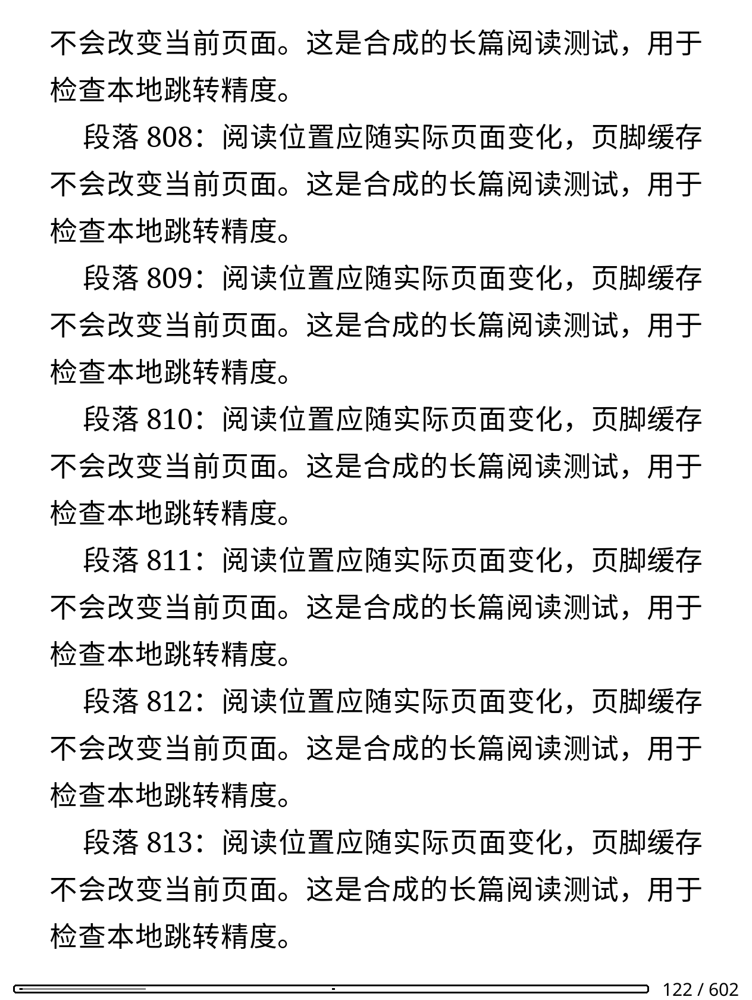
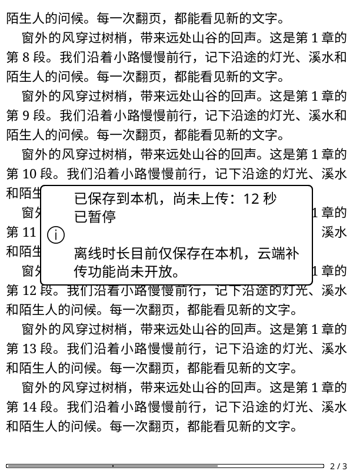
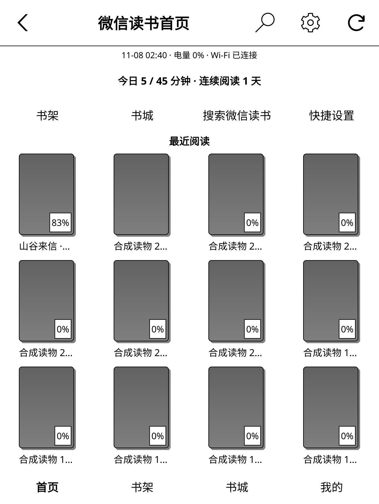
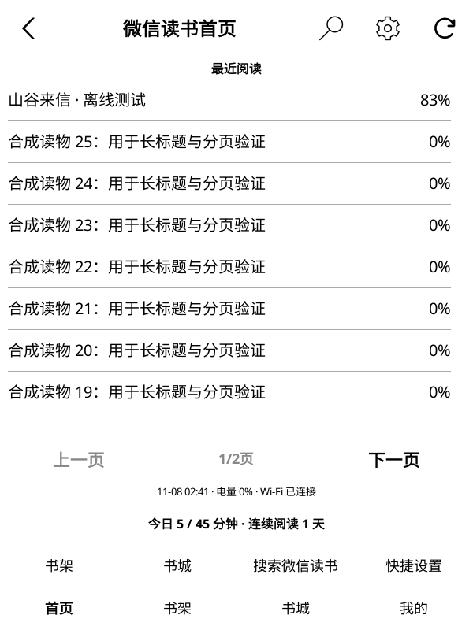
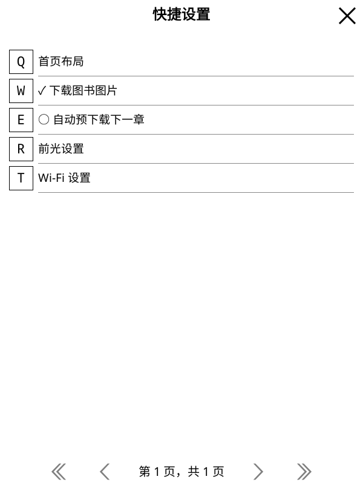
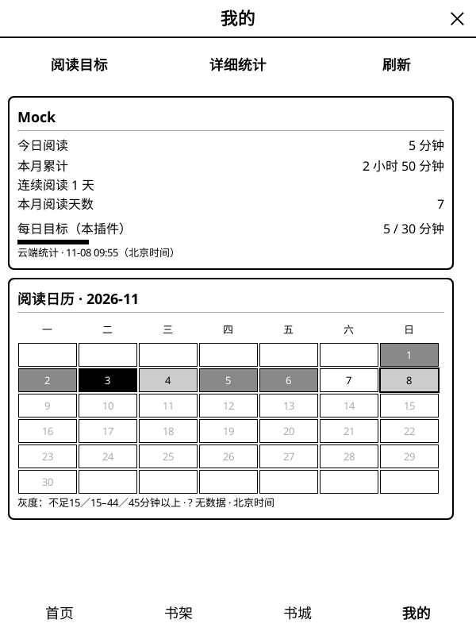
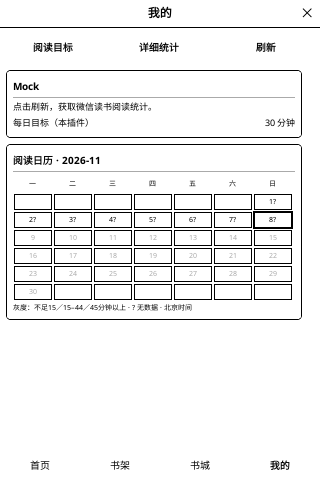

# 2026-11-08 开发阶段验证

本记录对应开发分支的独立更新通道和真实运行环境建设，不是正式发布验收。
剩余功能见 [开发清单](development-roadmap.md)。

## 实现与修正

- 更新元数据和安装包只从 `szxypi/weread.koplugin` 获取。
- 清除旧仓库的缓存更新信息；下载包及校验文件必须匹配本仓库和目标版本。
- 本仓库尚无正式 Release，GitHub 返回 404 时提示“尚未发布”，不当作普通网络故障。
- 修复首页与书城标题显示为禁用灰色的问题。
- 新增真实运行脚本；原有阅读与更新脚本不再依赖发行包没有包含的单元测试框架。

## 实际执行结果

| 项目 | 结果与覆盖范围 |
| --- | --- |
| Lua 单元／组件回归 | PASS：76 组，包括更新缓存隔离、外部包拒绝、版本匹配、404／503 区分 |
| Luacheck | PASS：171 文件，0 警告、0 错误 |
| 命名空间、Python 编译、差异格式 | PASS |
| Python 合成 HTTP 测试 | PASS：5 组 |
| 真实插件初始化 | PASS：官方 KOReader v2026.07.1、真实控件／字体／SQLite |
| 首页／书架／书城 | PASS：候选 ZIP 安装后，空页面、最近阅读、分页、列表／封面切换、搜索／推荐、关闭和账号清理 |
| 三种显示配置 | PASS：600×800/167 DPI、800×600/167 DPI、1072×1448/300 DPI，原生 BB8 灰度模拟 |
| 本地合成 HTTP + 真实 Lua Client | PASS：推荐首批与末批、搜索、书架、封面下载及缩略图缓存 |
| 阅读主链路 | PASS：真实 PluginLoader → Client/Content → EPUB → ReaderUI → 第二页 |
| 整本下载 | PASS：真实后台下载器与事件循环；六章正文、图片和脚注；ZIP 与章节完整性检查 |
| 更新主链路 | PASS：真实子进程、说明滚动、固定按钮、提醒持久化、SHA-256 失败拒绝、重试安装和旧目录备份 |
| 真实账号读写 | 未执行：没有测试授权环境 |
| Kindle 硬件 | 未执行：尚无连接设备；残影、真实触摸、按键、休眠与耗电仍待验证 |

界面测试通过控件回调执行操作，不等于对每个触摸坐标、手势或按键完成端到端验收。
合成 HTTP 服务器不会转发到微信读书，故不能证明线上接口当下仍接受相同请求。
更新测试替换 HTTP 读取边界为本地包，真实执行其余下载后的校验和安装步骤。

## 环境与复验

主机通过 OrbStack 运行 `weread-validation` 容器，基础镜像为 Ubuntu 24.04 ARM64。
使用官方 `koreader-linux-arm64-v2026.07.1.tar.xz`，未从源代码重新构建。
安装包、隔离设置、请求日志、截图及运行日志位于项目外层 `.validation/`：

- `bw-600/`、`bw-landscape/`、`bw-large/`：灰度页面验证。
- `reader-core/`：阅读、翻页与整本下载验证。
- `updater-candidate/`：更新安装与恢复验证。

Linux 环境依赖 SDL、Xvfb、xauth、zip/unzip、Python 3 和 git。
容器中的源码挂载为只读；测试只写独立目录，不访问日常阅读配置。

```sh
xvfb-run -a python3 scripts/test_discovery_runtime.py \
  --koreader /path/to/runtime --run-dir /path/to/new-discovery-run
xvfb-run -a python3 scripts/mock_weread.py --smoke --port 0 \
  --koreader /path/to/runtime --run-dir /path/to/new-reader-run
xvfb-run -a python3 scripts/test_updater_simulator.py \
  --koreader /path/to/runtime --run-dir /path/to/new-updater-run
```

## 实际截图

本地阅读位置采集与跳转精度后续验证：

- 88 组 Lua 回归、Luacheck 199 文件零警告、命名空间、Python 编译及差异格式通过；
  8 组 HTTP、5 组授权原型与 12 组补传只读测试通过。位置组件 28 项检查，进度组件 157 项检查。
- 使用真实 PluginLoader、ReaderUI 和 CREngine 打开 602 页合成 EPUB；先执行旧的整数百分比跳转以复现误差，
  同一目标在旧路径落到第 120 页，保留小数后落到目标第 122 页。
  人为把页脚缓存保留在 99% 后，采集结果仍对应实际的第 122 页。
- 原生事件切换到滚动模式，目标为 50.3125%；两种显示配置的实际位置距目标均不足 1 像素。
  页脚缓存保留为 1% 后，采集仍使用实际滚动位置。没有修改云端位置字段、字数比例模型或发起线上写入。
- `.validation/reader-position-verified-600/` 与 `.validation/reader-position-final-ko2/` 通过上述流程；
  [只含合成数据的实际位置结果](validation-assets/2026-11-08/reader-position-local.json) 保存原始数值。
  `.validation/reader-position-core-ko2/` 再验证账号／休眠取消、真实本地 HTTP、12 秒离线计时、覆盖日志、文件替换和六章整本下载。
- `.validation/reader-position-events-ko2/` 复验最终候选包，并验证真实原生事件回退保留小数目标，
  无处理器的原生控件不会被当作跳转成功。
- 复验命令：`xvfb-run -a python3 scripts/test_position_runtime.py --koreader /path/to/runtime --run-dir /path/to/new-run`。
  加上 `--width 1264 --height 1680 --dpi 300` 使用 KO2 尺寸配置；仍需实体设备及真实账号验收。
  完整原文坐标映射保持待实现状态，不将这次本地精度修正记作精确云端定位完成。



在线上报覆盖记录与去重预览后续验证：

- 87 组 Lua 回归、Luacheck 196 文件零警告、命名空间、Python 编译及差异格式通过；
  8 组 HTTP、5 组授权原型与 12 组补传只读测试通过。新增覆盖组件含 208 项检查，
  使用实际 SQLite 事务与逐秒独立对照，验证切分结果的秒数和具体范围。
- 默认在插件初始化时建立日志的历史边界；仅未覆盖且边界后的时段可作为去重预览中的可用时间。
  已记录范围优先识别为可能重叠；旧记录、丢失日志或边界之前的其它时段仍是未知。
  测试覆盖账号隔离、Web Cookie 与 gateway 账号不一致、无账号发送、范围并集、失败回滚及容量上限。
- 实际 ReadReport 使用原有请求字段，在带时长的 HTTP 前持久提交范围；SQL 写入失败时没有时长请求发出，
  零秒进度同步仍成功。此处未修改在线协议、签名、上报时长或阅读位置字段。
- `.validation/readtime-coverage-native-600/` 与 `.validation/readtime-coverage-final-ko2/`：
  真实 fork 子进程、官方 KOReader SQLite 和本地 HTTP 验证提交顺序。
  请求到达本地服务后，模拟回执丢失并退出子进程；重新打开日志，原有 12 秒离线记录仍在，
  Lua 和 Python 均预览为 12 秒可能已覆盖、0 秒未重叠、0 秒历史不明。
  [仅含数量的验证结果](validation-assets/2026-11-08/readtime-coverage-local.json) 来自实际运行账本。
- `.validation/readtime-coverage-audited-ko2/` 是加入无效身份降为未知、重复／交叉片段拒绝后的候选包复验，
  同样通过完整阅读、子进程覆盖日志、离线计时、文件替换和整本下载流程。
- `.validation/readtime-coverage-discovery-ko2/` 的四项导航、SQLite、后台加载、菜单、分页与灰度绘制回归通过。
  本轮未访问真实微信读书账号，未执行云端补传；服务器对覆盖时段的实际归属及正式补传发送协调仍待验证。

EPUB 来源绑定与离线账本后续验证：

- 86 组 Lua 回归、Luacheck 193 文件零警告、命名空间、Python 编译及差异格式通过；
  8 组 HTTP、5 组授权原型与 10 组补传只读测试通过。
- 新文件来源组件 28 项检查，离线时长组件 100 项真实 SQLite 检查；
  覆盖未知版本、混合断点、同路径替换、书籍不匹配、旧账本结构迁移及秒数保留。
  断点内容组件另验证版本 7 的章节不能作为版本 8 的已完成章节，并验证混合来源包装为未知版本。
- 官方 KOReader v2026.07.1 实际 CREngine 文档读取内嵌来源。测试打开版本 7，
  把书库版本改为 99，并在暂停期间用版本 8 替换同一路径；继续阅读保存的 12 秒仍绑定原文件版本 7。
  关闭原 ReaderUI 后重新打开相同路径，实际引擎读回版本 8 和新的来源摘要。
- `.validation/file-identity-final-600/` 与 `.validation/file-identity-final-ko2/` 均通过上述流程，
  以及真实 Client／Downloader 的六章整本下载、图片、脚注、ZIP 完整性与内嵌来源校验。
  `.validation/file-identity-discovery-ko2/` 通过首页／书架／书城／我的完整绘制和交互回归。
  三次运行使用内容相同的候选插件包；KO2 配置为 1264×1680、300 DPI，仍属于模拟显示。
- 来源元数据不含 Cookie、API Key 或阅读会话凭据；来源摘要不是整个 ZIP 的哈希或服务端证明。
  未扫码或上传时长，实际版本语义、在线／离线覆盖去重和写后回读继续待验收。

离线补传只读前置验证：

- 实际匿名 config 请求返回 401，feature 返回 200 且未提供 guest_token。报告为 `PARTIAL`，
  不把匿名读取成功当作补传接口已验证，见 [元数据报告](validation-assets/2026-11-08/eink-readtime-preflight.json)。
- 新增 9 组 Python 测试通过，包含真实 SQLite 的只读文件一致性、账号／版本分组、
  重叠／未来片段拒绝，以及禁止数据 POST 的传输保护。原有 8 组 HTTP 和 5 组授权原型测试同样通过。
- 本轮新增工作只涉及 Python 工具、CI 和文档，未更改插件运行代码。
  未扫码或发起数据写入；云端补传仍未接入 Lua。在线上报覆盖去重和文件版本来源为明确的后续前置条件。
  完整使用说明及剩余验证见 [补传原型说明](eink-readtime-prototype.md)。

本机离线时长记录后续验证：

- 85 组 Lua 回归、Luacheck 191 文件零警告、命名空间、Python 编译及差异格式通过；
  8 组 HTTP 服务和 5 组授权原型离线测试通过。离线组件 85 项检查使用实际 SQLite 事务。
- 覆盖元组去重／延长、开始边界裁剪、暂停时间戳平移、在线时间排除、未知重连间隔、
  休眠、时钟回拨与重启、写入失败不推进水位、事务回滚、五万片段上限、账号隔离，
  以及未来传输使用的确认幂等与中断状态保护。
- `.validation/offline-time-final-verified-600/` 与 `offline-time-final-verified-ko2/`：官方 KOReader 的真实
  statistics 插件、ReaderUI、墙钟／单调时钟及 SQLite；没有改写原生元组来伪造停留。
  实际阅读停留 6 秒，原生 ReadingPaused 等待 2 秒，再原生恢复阅读 6 秒，账本保存 12 秒。
- 原生 `insertDB` 将统计元组从内存刷入数据库后重采集，不重复保存前缀；重新打开账本总计不变。
  更换合成账号显示零，恢复原账号读回已有记录。服务端读写请求计数确认采集没有发送时长上报。
  随后的六章整本下载、图片／脚注与 EPUB 完整性检查继续通过。
- `.validation/offline-time-discovery-ko2/` 的完整首页／书架／书城／我的回归通过，
  验证默认关闭本机计时时，既有导航、后台进程、SQLite 和账号清理仍正常。
- 本轮没有发起新的微信读书接口请求；本机采集不依赖未完成的 E-Ink 授权。
  云端补传、生产账号入账、KO2 真实断网与耗电仍待验证。异常退出仅保证成功提交的前缀，不凭空补算尾部。



阅读进度会话与休眠恢复后续验证：

- 新增回归先复现关闭后仍发送旧读取、重开被旧忙碌状态卡住、账号切换后继续上传／重试、
  迟到跳转采集写入另一书籍，以及旧回执清掉新待上传位置的问题。修正后进度组件共 154 项检查通过。
  同时覆盖当前页重采集、冲突选择只执行一次、云端选择撤销旧上传、同书重开及跨书关书上传。
- 84 组 Lua 回归、Luacheck 186 文件零警告、命名空间、差异格式通过；
  8 组 HTTP 服务和 5 组授权原型离线测试通过。
- `.validation/progress-session-final-verified-600/`：安装候选 ZIP 后，经真实 PluginLoader、
  ReaderUI、EPUB 排版、UIManager 队列和 Client 操作本地合成 HTTP。
  排队读取／上传后更换合成账号，服务请求计数不增加；正常上传写入磁盘，再实际请求回读一致。
- 使用真实插件休眠／唤醒回调，取消休眠前上传并重新读取云端位置，未发送旧写入，
  比较一致后才恢复进度确认。随后六章整本下载、图片／脚注、EPUB 完整性检查仍通过。
- `.validation/progress-session-final-verified-ko2/`：1264×1680/300 DPI 的完整首页／书架／书城／我的
  灰度回归通过，包含后台进程、按账号 SQLite、原生菜单、分页、目标回读及账号清理。
- 这些结果证明的是本地合成服务与真实运行代码的衔接。没有执行生产账号写入，
  也未以回调测试替代 KO2 实际休眠、实体键和多设备在线验收。
  目录字数比例映射仍需升级，离线时长补传尚未实现。

首页定制与快捷设置后续验证：

- 84 组 Lua 回归、Luacheck 186 文件零警告、命名空间和差异格式通过；
  8 组 HTTP 服务测试、5 组 E-Ink 原型离线测试通过。
- `.validation/home-reviewed-small/`、`home-reviewed-600/`、`home-reviewed-landscape/`、
  `home-reviewed-ko2/`：320×480、600×800、800×600、1264×1680/300 DPI
  官方 KOReader 灰度运行通过。候选包使用合成账号和书籍，未访问生产账号。
- 原生 Menu 中选择列表、改变最近阅读数量、上移最近阅读模块、隐藏可选模块并恢复默认，
  检查配置回读和实际控件位置。原生 NextPage／PrevPage 事件分别到第二页和返回第一页。
  设置菜单打开时后台重绘延后，关闭后执行；休眠／唤醒回调取消并恢复分钟任务。
- 前光入口打开真实 KOReader FrontLightWidget，随后关闭；没有改变真实硬件的前光或网络。
  Wi-Fi 委托及迟到回调由组件测试覆盖。模拟器中的额外前光能力不代表 KO2 的硬件能力。
- 独立几何检查覆盖 320×480、600×800、800×600、1264×1680、1440×1920，
  每种尺寸检查默认／紧凑／列表／隐藏可选模块／模块重排五种配置，各含空／单本／24 本。
  检查页面与滚动区域边界、固定导航及设置入口；使用原生布局容器与字体／屏幕替身。
- 修正模块重排后局部刷新区域的绝对位置，避免底部状态栏仍刷新顶部区域。
  组件测试另覆盖设置保存失败回退、最多四个快捷入口、0% 电量、未知连接状态和定时取消。
- 用户选择稍后扫码，真实 E-Ink 登录和书架回读继续待验证；全局开发工作继续进行。
  实际实体键、触摸、前光、网络、休眠、耗电与残影仍需 KO2 真机。







“我的”与阅读目标后续验证：

- 82 组 Lua 回归、Luacheck 181 文件零警告、命名空间与 Python 编译通过。
  8 组 HTTP 服务测试和 5 组 E-Ink 原型离线测试通过。
- 日期／连续阅读测试分别在 `UTC`、`Asia/Shanghai`、`America/New_York`、`Pacific/Apia`
  下执行并纳入 CI。旧算法在 Apia 的历史日期复现 86400 秒偏差；新算法正确定位自然月首日。
- `.validation/profile-600/`、`profile-landscape/`、`profile-final-ko2/` 和
  `profile-final-small/`：600×800、800×600、1264×1680/300 DPI、320×480 真实灰度界面通过。
- 使用真实后台进程与 HTTP 读取统计，原生输入框把每日目标从 30 改为 45 分钟并回读 SQLite；
  “详细统计”切换周／月并返回“我的”；离线重开保留目标和统计，另一个账号看不到原缓存。
- 并发工作文件回归将两套 worker 的随机种子、时间与请求序号设为相同，验证各自结果独立回收。
  `.validation/profile-final-verified-ko2/` 为加入此修正后的候选包完整运行验证。
- 首次离线无数据、四项底部导航、月历、目标及统计窗口清理均覆盖。统计服务数据为合成数据，
  不代表生产账号返回、阅读时长上报和真机交互已验收。





当前可见书籍进度验证：

- 79 组 Lua 回归、Luacheck 176 文件零警告、命名空间、Python 编译通过。
  7 组原有 HTTP 测试与 5 组 E-Ink 授权原型离线测试通过；后者已纳入 CI。
- `.validation/progress-scroll-600/`、`progress-scroll-landscape/`、
  `progress-scroll-large/`：真实 HTTP → 后台子进程 → SQLite → 原生控件显示通过。
  覆盖封面、分页、列表、非分页长列表滚动、首页、离线缓存和账号隔离。
- 云端快照为 37%，账号绑定的本机待上传进度为 83%：快照保存为 37%，
  界面显示 83%；原有本机阅读章节和待上传位置保持不变。
- 长列表使用原生 ScrollableContainer 翻页滚动后读取新可见行，重绘保持滚动位置。
  布局几何检查覆盖 5 种尺寸、空／单本／30 本，新增百分比标识边界检查。
- `.validation/progress-ko2/` 的 1264×1680/300 DPI 灰度模拟配置同样通过。
  像素尺寸依据 [KOReader 的 KindleOasis2 实机日志](https://github.com/koreader/koreader/issues/9253)，
  实体按键、休眠与残影仍需设备验证。
- E-Ink 出票与二维码生成在实际服务返回 200，报告状态为 `PARTIAL`。
  本人扫码及其后的登录／书架回读尚未执行，详见 [授权原型说明](eink-authorization-prototype.md)。


排行榜／分类后续验证：

- `scripts/verify_bookstore.py` 在无登录条件下实际请求官方公开 Web 端点，分类树与
  飙升榜／图书分类前两批均返回 200。仅保留结构统计的原型报告见
  [bookstore-public-probe.json](validation-assets/2026-11-08/bookstore-public-probe.json)。
- `.validation/categories-600/`、`categories-landscape/`、`categories-large/`：
  78 组 Lua 回归、Luacheck 173 文件、7 组 Python 测试通过；三种真实灰度配置均通过。
- 用原生 Menu 选择榜单、父分类与子分类，用原生书城按钮换批，再走真实事件循环与
  Client 请求本地 HTTP；公开浏览时若触发登录检查，测试直接失败。
- 菜单截图与书单使用合成书籍。真实接口原型、合成 HTTP 和真实界面是不同验证层，
  仍需真实账号下载与 KO2 硬件验收。


后续相似推荐验证使用 `.validation/similar-600-v3/`、`similar-landscape/` 和
`similar-large/`：真实详情页按钮 → 事件循环 → Client → 本地合成 HTTP，
再通过书城原生按钮执行下一批、上一批。关闭详情后的排队任务没有发出请求或重开页面。
首批 20 本、末批 5 本，来源书籍和推荐会话保持一致。测试服务器拒绝错误会话。
本轮全部 77 组 Lua 回归与 6 组 Python 测试通过，Luacheck 172 文件零警告。
此结果仍不证明真实微信读书授权和服务端可用性。

封面与正文均为合成测试数据。以下截图由真实 KOReader 输出。


