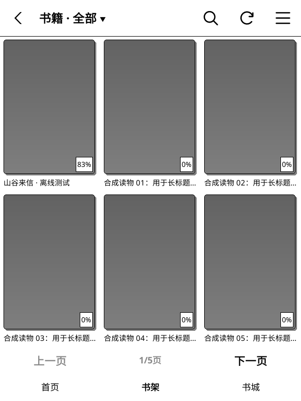
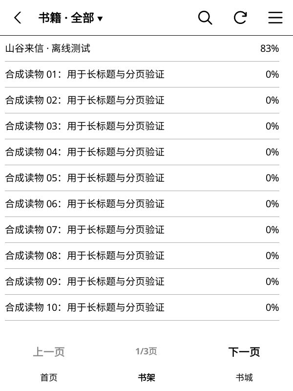
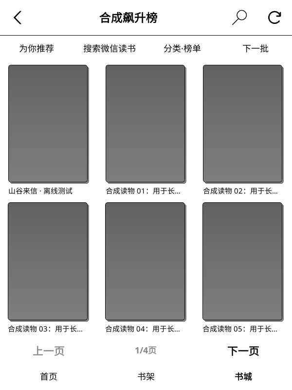
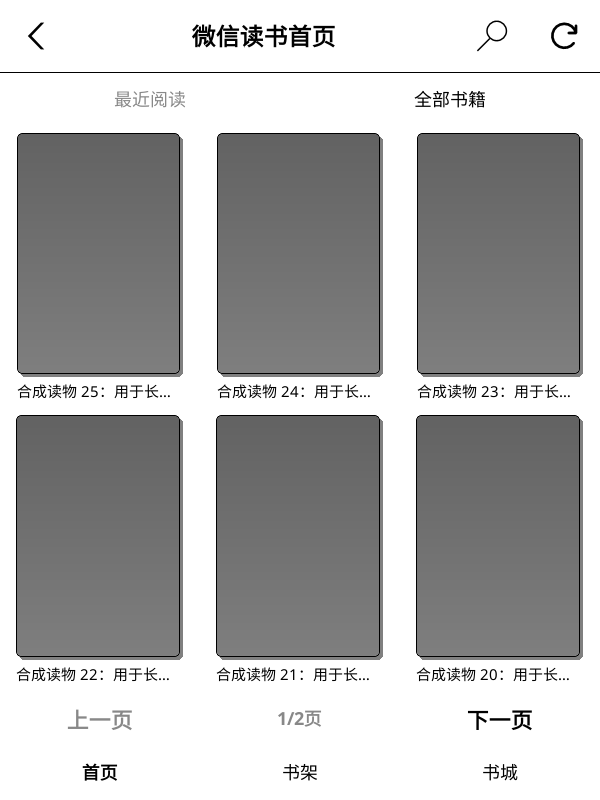
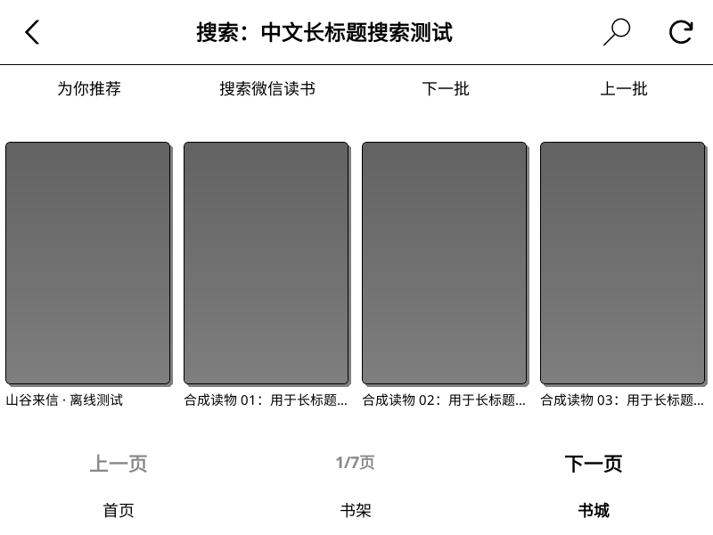
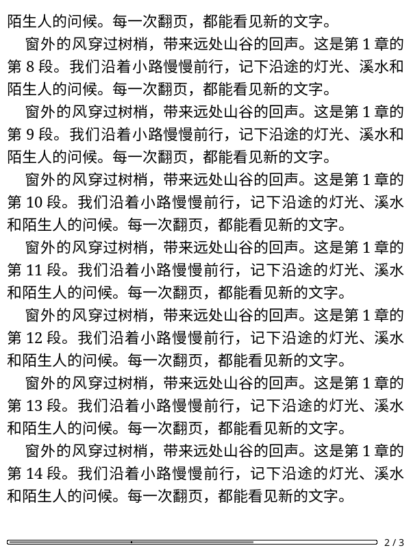

# 2026-11-08 开发阶段验证

本记录对应开发分支的独立更新通道和真实运行环境建设，不是正式发布验收。
剩余功能见 [开发清单](development-roadmap.md)。

## 实现与修正

- 更新元数据和安装包只从 `szxypi/weread.koplugin` 获取。
- 清除旧仓库的缓存更新信息；下载包及校验文件必须匹配本仓库和目标版本。
- 本仓库尚无正式 Release，GitHub 返回 404 时提示“尚未发布”，不当作普通网络故障。
- 修复首页与书城标题显示为禁用灰色的问题。
- 新增真实运行脚本；原有阅读与更新脚本不再依赖发行包没有包含的单元测试框架。

## 实际执行结果

| 项目 | 结果与覆盖范围 |
| --- | --- |
| Lua 单元／组件回归 | PASS：76 组，包括更新缓存隔离、外部包拒绝、版本匹配、404／503 区分 |
| Luacheck | PASS：171 文件，0 警告、0 错误 |
| 命名空间、Python 编译、差异格式 | PASS |
| Python 合成 HTTP 测试 | PASS：5 组 |
| 真实插件初始化 | PASS：官方 KOReader v2026.07.1、真实控件／字体／SQLite |
| 首页／书架／书城 | PASS：候选 ZIP 安装后，空页面、最近阅读、分页、列表／封面切换、搜索／推荐、关闭和账号清理 |
| 三种显示配置 | PASS：600×800/167 DPI、800×600/167 DPI、1072×1448/300 DPI，原生 BB8 灰度模拟 |
| 本地合成 HTTP + 真实 Lua Client | PASS：推荐首批与末批、搜索、书架、封面下载及缩略图缓存 |
| 阅读主链路 | PASS：真实 PluginLoader → Client/Content → EPUB → ReaderUI → 第二页 |
| 整本下载 | PASS：真实后台下载器与事件循环；六章正文、图片和脚注；ZIP 与章节完整性检查 |
| 更新主链路 | PASS：真实子进程、说明滚动、固定按钮、提醒持久化、SHA-256 失败拒绝、重试安装和旧目录备份 |
| 真实账号读写 | 未执行：没有测试授权环境 |
| Kindle 硬件 | 未执行：尚无连接设备；残影、真实触摸、按键、休眠与耗电仍待验证 |

界面测试通过控件回调执行操作，不等于对每个触摸坐标、手势或按键完成端到端验收。
合成 HTTP 服务器不会转发到微信读书，故不能证明线上接口当下仍接受相同请求。
更新测试替换 HTTP 读取边界为本地包，真实执行其余下载后的校验和安装步骤。

## 环境与复验

主机通过 OrbStack 运行 `weread-validation` 容器，基础镜像为 Ubuntu 24.04 ARM64。
使用官方 `koreader-linux-arm64-v2026.07.1.tar.xz`，未从源代码重新构建。
安装包、隔离设置、请求日志、截图及运行日志位于项目外层 `.validation/`：

- `bw-600/`、`bw-landscape/`、`bw-large/`：灰度页面验证。
- `reader-core/`：阅读、翻页与整本下载验证。
- `updater-candidate/`：更新安装与恢复验证。

Linux 环境依赖 SDL、Xvfb、xauth、zip/unzip、Python 3 和 git。
容器中的源码挂载为只读；测试只写独立目录，不访问日常阅读配置。

```sh
xvfb-run -a python3 scripts/test_discovery_runtime.py \
  --koreader /path/to/runtime --run-dir /path/to/new-discovery-run
xvfb-run -a python3 scripts/mock_weread.py --smoke --port 0 \
  --koreader /path/to/runtime --run-dir /path/to/new-reader-run
xvfb-run -a python3 scripts/test_updater_simulator.py \
  --koreader /path/to/runtime --run-dir /path/to/new-updater-run
```

## 实际截图

当前可见书籍进度验证：

- 79 组 Lua 回归、Luacheck 176 文件零警告、命名空间、Python 编译通过。
  7 组原有 HTTP 测试与 5 组 E-Ink 授权原型离线测试通过；后者已纳入 CI。
- `.validation/progress-scroll-600/`、`progress-scroll-landscape/`、
  `progress-scroll-large/`：真实 HTTP → 后台子进程 → SQLite → 原生控件显示通过。
  覆盖封面、分页、列表、非分页长列表滚动、首页、离线缓存和账号隔离。
- 云端快照为 37%，账号绑定的本机待上传进度为 83%：快照保存为 37%，
  界面显示 83%；原有本机阅读章节和待上传位置保持不变。
- 长列表使用原生 ScrollableContainer 翻页滚动后读取新可见行，重绘保持滚动位置。
  布局几何检查覆盖 5 种尺寸、空／单本／30 本，新增百分比标识边界检查。
- `.validation/progress-ko2/` 的 1264×1680/300 DPI 灰度模拟配置同样通过。
  像素尺寸依据 [KOReader 的 KindleOasis2 实机日志](https://github.com/koreader/koreader/issues/9253)，
  实体按键、休眠与残影仍需设备验证。
- E-Ink 出票与二维码生成在实际服务返回 200，报告状态为 `PARTIAL`。
  本人扫码及其后的登录／书架回读尚未执行，详见 [授权原型说明](eink-authorization-prototype.md)。





排行榜／分类后续验证：

- `scripts/verify_bookstore.py` 在无登录条件下实际请求官方公开 Web 端点，分类树与
  飙升榜／图书分类前两批均返回 200。仅保留结构统计的原型报告见
  [bookstore-public-probe.json](validation-assets/2026-11-08/bookstore-public-probe.json)。
- `.validation/categories-600/`、`categories-landscape/`、`categories-large/`：
  78 组 Lua 回归、Luacheck 173 文件、7 组 Python 测试通过；三种真实灰度配置均通过。
- 用原生 Menu 选择榜单、父分类与子分类，用原生书城按钮换批，再走真实事件循环与
  Client 请求本地 HTTP；公开浏览时若触发登录检查，测试直接失败。
- 菜单截图与书单使用合成书籍。真实接口原型、合成 HTTP 和真实界面是不同验证层，
  仍需真实账号下载与 KO2 硬件验收。




后续相似推荐验证使用 `.validation/similar-600-v3/`、`similar-landscape/` 和
`similar-large/`：真实详情页按钮 → 事件循环 → Client → 本地合成 HTTP，
再通过书城原生按钮执行下一批、上一批。关闭详情后的排队任务没有发出请求或重开页面。
首批 20 本、末批 5 本，来源书籍和推荐会话保持一致。测试服务器拒绝错误会话。
本轮全部 77 组 Lua 回归与 6 组 Python 测试通过，Luacheck 172 文件零警告。
此结果仍不证明真实微信读书授权和服务端可用性。

封面与正文均为合成测试数据。以下截图由真实 KOReader 输出。






